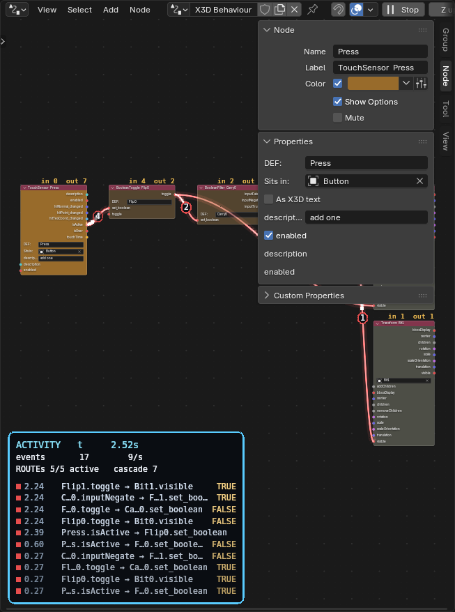
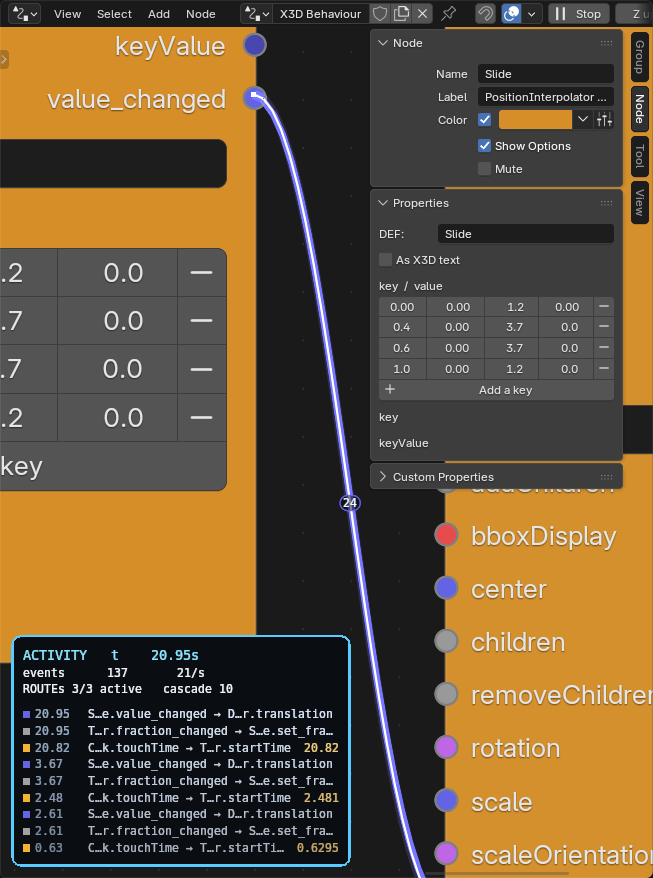

# X3D behaviour graph for Blender (proof of concept, 22 Nov 2026)

Read next: [a student's guide](behaviour-graph-for-students.md) and the [scripting primer](behaviour-graph-primer.md).
Try it: the [Wire Lab](https://hagopjay.github.io/x3d.demo/demos/wire-lab/v2/). Code: x3d-blender-io pull request 71.
Paths below are in the x3d-blender-io repository.

An X3D scene's behaviour (sensors, timers, interpolators, event utilities, followers and the ROUTEs between them) as an
editable graph: plain Python data, a Blender node tree, and X3D text, kept in step.

| File | What it is |
|---|---|
| `source/behaviour_catalogue.py` | generated from the X3D Unified Object Model 4.0 by `tools/behaviour_catalogue_gen.py` (`--check` fails when stale): 45 behaviour node types with 303 fields, 32 target types |
| `source/behaviour_graph.py` | the graph without Blender: parse from X3D, validate, edit, emit, weave into a document, compare, lay out, JSON; and the scripting methods (`Behaviour`, `add`, `target`, `>>`) |
| `source/behaviour_nodes.py` | the Blender node tree `X3DBehaviourTree`: one node class per X3D node, one socket class per field type; `apply`, `read`, `target`, `import_graph` |
| `tools/behaviour_roundtrip.py` | import a file with its graph, optionally set fields, export, print the graph difference |
| `tools/behaviour_eyetest.py` | open a real Blender window, import each world with its graph, screenshot the editor, Play it with real (simulated) clicks, check Esc restores everything |
| `tools/behaviour_replay.cjs` | play the same real mouse clicks on two files in X_ITE and compare what the scene did |
| `tests/test_behaviour_graph.py`, `tests/test_behaviour_nodes_bpy.py` | 23 plain-Python and 17 Blender tests |
| `tests/behaviour/` | `route-demo.x3d`, the three Wire Lab worlds, and `route-cases.json` (55 ROUTE legality cases shared with the browser Wire Lab) |

## Use

* Import: tick "Behaviour as node graph" (off by default). The scene gets a node tree in `scene.x3d_behaviour_tree`.
  If a node editor is open, the tree is shown in it (one already showing an X3D Behaviour tree first, else the largest),
  laid out so no two nodes overlap, and framed. No other editor is changed. The import's last line says where the graph
  went: "X3D Behaviour: 3 nodes, 3 ROUTEs in node tree 'X3D Behaviour', shown in the node editor." or, with no node
  editor open, "… To see them, switch any editor's type to X3D Behaviour."
* Edit: node editor, tree type "X3D Behaviour". A link between two field types is removed as it is made.
* Export: a scene with a tree writes it. A scene without one exports exactly as before.
* Script (no window needed):

```python
from io_scene_x3d import behaviour_graph as bg, behaviour_nodes as bn   # the package name depends on the install

b = bg.Behaviour()
click = b.add("TouchSensor", "Click", parent="Door")
timer = b.add("TimeSensor", "Timer", cycleInterval=2)
slide = b.add("PositionInterpolator", "Slide", key=[0, 1], keyValue=[(0, 0, 0), (0, 2, 0)])
door = bn.target(b, bpy.data.objects["Door"])
click.touchTime >> timer.startTime
timer.fraction_changed >> slide.set_fraction
slide.value_changed >> door.translation
bn.apply(b, bpy.context.scene)
```

## Rules the exporter keeps

1. Illegal ROUTEs are left out and named in a head `meta` line.
2. The graph's names are reserved before any other DEF: a node called `Timer` is `Timer` in the file.
3. A target is written under its name in the graph (for an imported file, the DEF it came with).
4. A ROUTE whose target is not exported is left out and counted in a head `meta` line.
5. Keyframes of an object the graph drives are not sampled into a second set of interpolators.
6. On import with the graph, keyframes the same import baked for an object the graph drives are removed (and reported).

## Measured (22 Nov 2026; Blender 5.3.0 bpy wheel, Python 3.13.18, x3d.py 4.0.65.8, X_ITE 16.7.1 headless)

| File | ROUTEs | Default import path, re-exported | Graph path, re-exported |
|---|---|---|---|
| route-demo.x3d | 22 | 24 ROUTEs; 9 nodes with changed fields, 1 node added | 22; no difference |
| door.x3d | 3 | 2; all 3 nodes and 3 ROUTEs lost | 3; no difference |
| counter.x3d | 5 | 0; all 4 nodes and 5 ROUTEs lost | 5; no difference |
| snake.x3d | 6 | 2; all 4 nodes and 6 ROUTEs lost | 6; no difference |

Behaviour replay with real clicks (`tools/behaviour_replay.cjs`): door identical before and after the Blender trip. The
counter differed in version 1, because the importer did not read `visible` on a Transform (lamps that start hidden came
back shown). Version 2 reads it: 5 real clicks give the same lamp states before and after the trip.

## Version 2: play it, edit it with real widgets, keep what is hidden

### Play in the viewport

`source/behaviour_sim.py` is the X3D event model in plain Python (no Blender, no browser): `Simulation(graph)`, then
`start`, `step(now)`, and `press` / `release` / `drag` / `click` for the pointer. `source/behaviour_play.py` runs it on
the scene: `Player(scene)` writes each value that reaches a target onto the Blender object, material or light it is
bound to, and `stop()` puts everything back.

In Blender: the **Play** button in the X3D Behaviour editor's header, or the 3D viewport's sidebar (N), tab **X3D**.
While it plays, click or drag what a sensor senses; nodes glow as they send events; **Esc** stops and restores the scene.
Nothing is keyframed and nothing is left changed.

| Simulated | Not simulated (named in the sidebar, never silently skipped) |
|---|---|
| TimeSensor; Scalar, Position, Position2D, Color (HSV) and Orientation (slerp) interpolators; EaseInEaseOut; the Scalar, Position and Position2D Spline interpolators; SquadOrientationInterpolator; Boolean and Integer sequencers; BooleanFilter, BooleanToggle, BooleanTrigger, IntegerTrigger, TimeTrigger; the Scalar, Position, Position2D, Color and Orientation dampers and chasers; TouchSensor, PlaneSensor, CylinderSensor (including disk mode and angle limits) and SphereSensor from the pointer; ProximitySensor from the viewer | Coordinate and Normal interpolators, coordinate and texture-coordinate followers, VisibilitySensor, TransformSensor, KeySensor, StringSensor, LoadSensor, Scripts and PROTOs |

Shown on Blender data: Transform translation, rotation, scale, visible; material baseColor / diffuseColor,
emissiveColor, transparency, roughness, metallic; light color and on; Viewpoint set_bind (the scene camera). Anything
else an event reaches is listed as "Not shown".

**Axes.** The exporter writes a parentless object's Transform as `global_matrix @ matrix_world` and a child's as its
matrix in its parent's space. The player turns each object into that Transform, changes the field the event set, and
turns it back. So a value means in the viewport what it means in the file, and a child's values are already in Blender's
axes.

### The simulator is checked against X_ITE

`tools/behaviour_sim_judge.cjs` records every event at every ROUTE source in X_ITE, with X_ITE's own time stamps, while
real mouse clicks are made. `tools/behaviour_sim_judge.py` gives the simulator the same pointer events at the same
times and compares each stream. Recorded 22 Nov 2026, X_ITE 16.7.1, headless Chromium with software GL; the traces are
in `tests/behaviour/x_ite_traces/` and replayed by `tests/test_behaviour_sim.py` on every run.

| File | Event streams | Agree | Worst gap |
|---|---|---|---|
| door.x3d (2 clicks) | 2 | 2 | 0.000001 |
| counter.x3d (5 clicks) | 3 | 3 | 0 |
| snake.x3d (8 s) | 6 | 6 | 0.0048 (followers) |
| probe.x3d (2 clicks; every simulated kind, built by `tools/behaviour_probe.py`) | 25 | 25 | 0.0645 (followers) |
| probe-spline.x3d (2 clicks; EaseInEaseOut, the Spline interpolators, Squad, PositionDamper2D; same tool) | 12 | 12 | 0.000001 exact; 0.0202 (follower) |
| probe-drag.x3d (7 real drags on 5 sensors, `probe-drag.drags.json`; same tools) | 7 | 7 | 0.000007 (matched event for event) |
| probe-proximity.x3d (a camera flight a TimeSensor drives through the Viewpoint; 10 s) | 13 | 13 | 0.000001 |

Tolerances: 0.002 for everything exact, 0.08 for dampers and chasers and what they feed (X_ITE steps them by its frame
rate, the simulator by the clock). Discrete streams must also have the same number of events. What the comparison
taught, all now in the simulator: X_ITE's TimeTrigger and IntegerTrigger answer `true` only; a looping TimeSensor
counts its cycles from `startTime`, not from when the world loaded; a follower chases where its destination was one
frame ago; colours are mixed through HSV, in dampers too; a chaser's answer to a jump is eased (half a cosine), not a
straight ramp. Not judged: PositionChaser2D and ColorChaser (same code as a judged one), and sensors the caller drives.

**Splines, easing and Squad (25 Nov 2026).** Written from X_ITE 16.7's own code and judged against X_ITE 16.7.1 on
`probe-spline.x3d`, recorded the same way. What X_ITE does where the standard leaves room, all now in the simulator:
EaseInEaseOut sends the eased weight within the current key segment (0 to 1), not a fraction mapped back onto the keys,
and scales ease in and ease out down when they add up to more than 1; a Spline interpolator's velocities, when there are
fewer than keys, are padded with zeros (two velocities are not "first and last"); `normalizeVelocity` scales every
velocity but the last to the path length; an open curve's end tangents are zero and a closed curve's first tangent
wraps; tangents are weighted by the key spacing on each side; Squad uses Shoemake's inner points, with an open path's
ends as their own. The judge was checked against five deliberately wrong versions (easing off by 2%, the last velocity
normalised, two velocities read as first and last, Squad as plain slerp, a closed curve treated as open): it rejects
all five. **X_ITE 16.7.1 cannot load a world with a vector Spline interpolator (2D or 3D) whose `keyVelocity` is set and
`normalizeVelocity` is true** ("e.norm is not a function"); the scalar one loads. The simulator runs that case as X_ITE's
code intends; it is not judged. Through Blender, `probe-spline.x3d` keeps 19 of 20 ROUTEs: the one into a
TextureTransform is left out and named (targets are Transform, Viewpoint, lights and materials).

### Typed field editors

Each single-value field has a real widget (checkbox, number, seconds, colour swatch, vector, axis and angle). An
interpolator's or sequencer's `key` and `keyValue` are one table, a row per key, with add and remove. A node shows its
main fields and whatever has a value; the sidebar shows every field. The stored data is still the X3D text of the file:
a widget reads and writes that text, and a value equal to the standard's default is not stored. **As X3D text** in the
sidebar shows the raw text again.

**Z up** in the editor's header shows places and turns in Blender's axes for nodes whose values reach only parentless
objects (those are the values in the file's Y-up world axes). Only the display turns; the text does not. Values for a
child object are in its parent's axes and are never turned.

### visible="false"

The importer now hides the objects made under a node whose `visible` is false (viewport and render) and marks them
`x3d_visible_false`; the exporter writes `visible="false"` back for an object that is marked and still hidden.
Unhiding it in Blender is the user's choice and is written as visible.

**Drag sensors (26 Nov 2026).** CylinderSensor and SphereSensor run from the pointer's ray and the viewer (where it
is, which way is back), both in the sensor's own coordinates: `Simulation.press(..., ray=, eye=)` and
`drag(..., ray=)`; in Blender, Play takes them from the 3D viewport. The code follows X_ITE 16.7 line by line: the
cylinder's billboarded planes and asin track, its disk mode when the axis points within `diskAngle` of the viewer,
`minAngle` / `maxAngle` by accumulated angle, and "behind" from Inventor's root order; the sphere's track with its
fallback off the sphere, its inverse when pressed behind the centre, `autoOffset`; rotations kept as X_ITE keeps them
(half angle wrapped into [0, pi), compared exactly, read back as made until multiplied). Judged on `probe-drag.x3d`:
`tools/behaviour_sim_judge.cjs` with a drags file makes real drags in X_ITE 16.7.1 and logs every pointer event;
`tools/behaviour_sim_judge.py` rebuilds each ray from the pointer and the Viewpoint, takes the press point from a
TouchSensor beside each drag sensor, and runs the simulator. What the recording taught: the press point is X_ITE's
pick at the pixel's centre (0.5 px right and up), while the drag ray uses the pointer as given; X_ITE follows a press
with one motion on the same ray (a SphereSensor's track point moves off the picked point); X_ITE stamps a press with a
fresh clock and a motion with its last frame's, so a driven sensor is compared event for event, in order, with equal
counts. 7 of 7 streams agree (worst 0.000007). Six deliberately wrong versions are rejected (no motion after the
press, sphere ignoring "behind", cylinder never "behind", limits ignored, never a disk, sphere forgetting its offset);
the two "behind" ones passed until the probe got boxes behind their sensor's origin. Through Blender the world keeps 7
of 12 ROUTEs: the 5 into empty Transforms (hit markers) are left out and named. A sensor's empty parent now keeps its
DEF on export (it came back as `OB_CylBase`).

**ProximitySensor (26 Nov 2026).** `Simulation.viewer(sensor, position, orientation, now, center_of_rotation=)` takes
the viewer in the sensor's own coordinates once a frame: inside the box (`center`, `size`; size -1 -1 -1 is
everywhere) it is active; entering sends isActive, enterTime and all three of position, orientation and centre of
rotation; inside, only what changed; leaving sends isActive false and exitTime. In Blender, Play gives it the scene
camera when the viewport looks through it, else the viewport's eye, with Blender's orbit centre as the centre of
rotation; and a ROUTE into a Viewpoint's `position` or `orientation` now moves the camera, so a scripted camera flight
plays. Judged on `probe-proximity.x3d`: the camera flies a loop through a gate and a turned room with an off-centre
box; a root ProximitySensor of size -1 is X_ITE's own report of the viewer each frame, and the judge hands that pose to
the simulator's other sensors in their coordinates. The recorder now also logs what every source held when recording
began (the room was already active). What the recording taught: X_ITE tests the box against the camera as it was
drawn, one frame behind a viewpoint a ROUTE moves, and reports where the camera is now (`test_position`). 13 of 13
streams agree; four wrong versions are rejected (box tested on the current camera, centre ignored, orientation left in
world axes, the sensor's frame without its rotation). Not caught by this judge: a continuous output re-sent unchanged.
Fixed on the way: a sensor or target in a DEF'd Transform whose unnamed child Transforms hold shapes was bound to a
child (the importer gives them the parent's DEF and name, and calls the Transform "Name.001"); the binding now takes the
outermost object that carries the DEF.

**Host-eyes witness.** `tools/behaviour_eyetest.py` ends by writing `host-eyes.json`, a `loom.witness/1` record with
the fields loomkit's own writer writes (`origin` executed, `finished_at` included): the subject is the add-on source
folder's Loom candidate digest, taken before the add-on loads and again at the end (changed means status error); the
instrument is the Blender version, flags and window; per world it records whether it was shown, overlaps, played and
restored, drags and proximity toggles; every screenshot is evidence by sha256; `development` is true while the source
has uncommitted changes. Pass only when every world shown has no overlapping nodes and every world played was put
back. Judged by loomkit itself (x3d.loom main, `accept.judge`): the 8-world run of 26 Nov is accepted (pass, grade C);
the first draft of the record is refused as stale (its own digest), and a development run, a fail, coverage of 7
worlds and one screenshot changed by one bit are each refused.

## Looked at on a real screen (25 Nov 2026)

`tools/behaviour_eyetest.py` opens a Blender window (`--factory-startup --enable-event-simulate`, 1600 x 1000), loads
the add-on from a checkout, and for each world imports it with the graph, screenshots the window and the editor, presses
Play, moves the pointer onto what a sensor senses and clicks through Blender's own event queue (so the modal operator,
the ray cast, the glow and Esc run as they do for a person), then checks the scene against its state before Play.
Blender 5.3.0, macOS 26 arm64. Same rig, add-on `main` 0eb4809 against this version:

| | main 0eb4809 | this version |
|---|---|---|
| Import shows the graph in the open node editor | 0 of 5 worlds | 5 of 5 |
| Pairs of overlapping nodes (counter, probe, route-demo) | 70 (1, 31, 38) | 0 |
| Esc puts every object back (`matrix_basis`, hidden flags) | 5 of 5 | 5 of 5 |
| A real click on the sensed object makes the target move or light | door, counter, probe, route-demo | same |

What the screenshots showed and this version changes: the import opened nothing; nodes overlapped because the layout
spaces rows evenly and a target node is several rows tall (`unstack` now pushes them apart after the first draw, when
the editor knows each node's height); an interpolator with 48 keys drew 48 rows on the node (the node now shows six,
the first five and the last, with a line pointing to the sidebar, which shows all); `startTime="1e+30"` (the file's
"not until an event") was drawn as thirty cut-off digits (it is now its X3D text, labelled "never").

The glow painted a node solid orange for as long as it kept sending, so a running timer's fields could not be read; a
node now flashes (85% of the way to orange) for the first 0.35 s of a run of events and then holds a steady amber (35%)
while it keeps sending (`GLOW_FLASH`, `GLOW_BUSY` in `behaviour_play.py`). The importer still bakes interpolators into
actions (`Door_x3d`, ...) while the graph is built: 7 actions in 4 of the 5 worlds, each on an object the graph drives,
so the timeline played a second copy. The import now removes an action when this import made it, a ROUTE drives its
object, and nothing else uses it, and says so in its report; actions that existed before the import are never touched.
Without the graph, nothing changes (the baked keyframes stay).

Seen and not changed: the sidebar repeats an unlinked input (`key`, `keyValue`) as a bare label after the node's panel
(Blender draws unlinked inputs there).

## Add-on 2.7.5 (26 Nov 2026): a timer started in the past, presets to graph, play axes

Code: x3d-blender-io pull request 89.

**A timer started in the past.** X_ITE counts a TimeSensor's cycles from `startTime` whether it loops or not. Started
with a `startTime` already in the past, a non-looping timer begins part way through a cycle and stops when that cycle
ends; and a `startTime` that arrives in the frame a cycle ran out is ignored. The simulator now does the same. A new
probe world agrees with X_ITE 16.8.1 on 14 of 14 event streams (3 disagreed before; headless Chromium, software GL, one
short press and one held 4.5 s). The seven older recordings still agree. This looks like a departure from the
standard's clause 8.2.4, which was not re-read (Suspected); the simulator follows X_ITE.

**Presets to graph.** A button in the X3D Behaviour editor's header and in the 3D view sidebar (tab X3D) turns the old
click and proximity presets (action animate or viewpoint) into the sensors, timers, interpolators and ROUTEs the
exporter wrote for them, as nodes you can rewire. On the test scene the export before and after has the same 8
behaviour nodes and 10 ROUTEs. Camera tours are left as presets and named in the report.

**Play axes.** Under Play in the sidebar, Forward and Up choose the axes Play uses (default -Z and Y, taken once from
the session's last export). Checked against the exporter for three axis pairs.

**Loss report.** With "Behaviour as node graph" on, a ROUTE the graph kept is no longer in the scene's list of import
losses. The log lines and strict mode run before the graph exists and still list it.

Not checked: the new buttons on a real screen; X_ITE on a file converted from presets.

## Add-on 2.7.6 (26 Nov 2026): hostile graphs, large graphs, honest loss reports

Code: x3d-blender-io pull request 92.

**It no longer falls over on bad input.** A fuzzer (`tools/behaviour_fuzz.py`, repeatable from `--seed`) builds random
graphs and calls. Legal graphs were already clean. Hostile ones (text where a number belongs, NaN, infinities, ROUTEs
of the wrong type, times that run backwards) were not:

| 2,000 hostile graphs, seed 1 | before | after |
|---|---:|---:|
| raised an error out of the simulator | 1,055 | 0 |
| delivered NaN, infinity or a wrong-shaped value to an object | 271 | 0 |

The rule now: field text that is not a value gives the standard's default; a NaN, an infinity or a value of the wrong
shape is dropped and counted, never delivered; a node that fails is left out of that one event and named, and the rest
of the graph runs on. Pressing Stop puts location, rotation and scale back exactly as they were typed.

**Play keeps up with large graphs.** Player.step in Blender, median of 300 steps (`tools/behaviour_bench.py`, bpy 5.3.0,
shared 4-core Xeon, `PYTHONHASHSEED=3`; 60 steps per second needs 16.7 ms or less):

| one timer driving N interpolators | N=300 | N=1000 | N=5000 |
|---|---:|---:|---:|
| 2.7.5 | 5.87 ms | 30.4 ms | did not finish in 40 s |
| 2.7.6 | 2.39 ms | 4.45 ms | 28.0 ms |

Same events in the same order with the same values. Not measured: a real viewport redraw, which costs more. Still
slow: building the node tree itself from a large file (about 7 s for 600 nodes).

**The loss report tells the truth everywhere.** With "Behaviour as node graph" on, the log lines and
`X3D_IMPORT_STRICT=1` no longer call a ROUTE lost when the graph kept it.

## Add-on 2.7.7 (26 Nov 2026): the editor shows its own events

**Activity while playing.** Press Play and every ROUTE that really delivers an event lights up in its field type's
colour: packets travel from socket to socket, a badge on each link counts its events, each node shows events in and
out, and a small panel lists events, events per second, active ROUTEs, the widest cascade and the last events.
Nothing moves unless the simulation delivered an event; the totals equal the simulation's own log (unit tests).
Switches are under Play, "Activity"; "Copy activity report" puts the numbers on the clipboard.




These two pictures are from a real Blender 5.2.2 window opened by a GitHub Actions job (Xvfb, Mesa llvmpipe, OpenGL
4.5); a reviewer read them. Nobody has yet looked at the overlay on a real graphics card or on a Mac. Cost on
Player.step, 1,000 interpolators on one timer: 4.35 ms off, 4.99 ms on (`tools/behaviour_bench.py --bpy`, median of
300 steps, `PYTHONHASHSEED=3`).

**Recordings.** "Record" (or `tools/behaviour_record.py`) writes an `x3d.activity/1` file: every delivery in order,
plus what was done to the scene (click, press, drag, and on which object). A search in another lane rebuilt the door
and the counter from such recordings (x3d.loom, self-coding).

**Three more interpolators.** CoordinateInterpolator, CoordinateInterpolator2D and NormalInterpolator are simulated and
agree with X_ITE 16.8.1 on every stream of the probe world. The Player does not move mesh vertices yet.

**A turn of 0, pi, 2 pi.** Recorded on X_ITE 16.8.1: with the middle key a hair under pi the object rocks to pi and
back; a hair over, it makes one full turn. The simulator agrees at every sample. To turn a full circle use four keys or
more. Numbers are now written in the shortest form that reads back exactly, because six decimals changed this motion.

**A judge with its own noise floor.** `tools/behaviour_pair_judge.py` replays two X3D files in X_ITE, interleaved, and
answers same, differs or unclear against the noise it measured in the same session.

**Measured, not fixed.** Building the node tree from a large file is still slow inside Blender: 601 nodes about 6 s,
2,001 nodes 68.8 s (`tools/behaviour_bench.py --tree`).

**In the browser.** Wire Lab version 3 (Demo 73) shows the same thing on X_ITE: real events riding the wires, a flywheel
view of the feedback loops, and a lane that replays a Blender recording beside the live browser run.

## Add-on 2.7.8 (26 Nov 2026): joints, Switch and shader fields; a judge that knows when it cannot see

**More things a ROUTE can end at.** HAnimJoint (`rotation`, `translation`, `scale`, `center`), HAnimSite,
`Switch.whichChoice`, and a ComposedShader's own fields declared with `<field>`. The simulator agrees with X_ITE 16.8.1
on 16 of 16, 3 of 3 and 12 of 12 event streams of the three probe worlds. In Blender, Play poses the joint's bone and
shows the chosen Switch branch; a site moves only if an object carries its name; shader fields are delivered in the
simulation and listed as not applied. X3D 4.0 gives HAnimSegment no placement field, so a ROUTE to its `rotation` is
refused by name. Not yet seen in a real Blender window.

**The pair judge after real scenes.** Its first use on real files showed it was blind on free-running loops: X_ITE
gives a looping timer wall-clock phase, so two runs one after the other disagree with themselves, and the judge called
everything "same". Now the two files run at the same moment and are compared at X_ITE's own time stamps; a noise floor
too high to tell gives "unclear, blind", never "same"; rotations are compared by the angle between them. Measured: a
20 s loop watched 4 s against itself reads "same" with floor 0, against a changed keyValue "differs"; a turntable keyed
3.14159265 against one printed 3.141593 differs by about 3.1 rad.

## Add-on 2.8.0 (26 Nov 2026): all 57 event nodes

X3D 4.0 has 73 nodes that send or receive events on their own (X3DUOM); 12 are Web Audio and 4 are DIS networking, which
leaves 57. "Covered" means four things, so the add-on counts four rungs, from the code, with one tool
(`tools/behaviour_coverage.py`; the table is pinned by `tests/test_behaviour_coverage.py`):

| rung | meaning | 2.7.8 | 2.8.0 |
|---|---|---:|---:|
| wired | the graph reads, shows and writes the node and its ROUTEs | 45 | 57 |
| simulated | the simulator computes its events without a browser | 39 | 57 |
| judged | those events agree with X_ITE 16.8.1 recordings, stream for stream | 38 | 56 |
| played | Play in Blender's viewport feeds and shows it | 38 | 50 |

What was added, and the instrument behind each number (all against X_ITE 16.8.1 recordings):

| nodes | what they needed | streams that agree |
|---|---|---|
| CoordinateChaser, CoordinateDamper, TexCoordChaser2D, TexCoordDamper2D | list values | 28 of 28 |
| LoadSensor, AudioClip, MovieTexture | a declared `Resources` table: what each URL would load, and when | 171 on 4 probes |
| TransformSensor, VisibilitySensor, Collision | a `World`: shapes, poses and a viewer as plain data | 59 of 59 |
| LinePickSensor, PointPickSensor, PrimitivePickSensor, VolumePickSensor | `World.pick` | 129 of 129 |
| GeoPositionInterpolator, GeoProximitySensor, GeoTouchSensor | geographic conversions | 102 of 102, and 754 conversions |
| Script | a Python handler the author enables (`Hosted`) | judged |
| CollisionSensor | contacts from a physics engine (`Hosted`) | consistency check only |

Also in 2.8.0:

- **A warning for half turns.** Rotation keys pi apart (0, 3.1416, 6.2832) have no shortest way round, so the direction
  is decided by rounding. Two gallery demos turned backward or both ways on X_ITE 16.8.1. The graph now warns with code
  `half-turn`, names the node and keys, and Play lists it. Write a full turn with four keys: 0, 2.0944, 4.1888, 6.2832.
- **Fewer faults.** A hostile fuzzer isolated 476 to 608 faults per 2,000 graphs (division by zero, overflow); now 7 to 22,
  all its own deliberate handler error. 0 failed graphs on seeds 1 to 5 (`tools/behaviour_fuzz.py`).
- **Speed** (`tools/behaviour_bench.py`, median ms per step at 1,000 nodes, budget 16.7): World sensors 15.4 to 7.8.
  Over budget and open: list dampers of 100 points (84.8, from 181) and pick sensors (21.4).

Not proven: CollisionSensor against our own physics; VisibilitySensor, TransformSensor, Collision and the pick sensors
in Play; pick GEOMETRY mode beyond box, sphere, point and line against box; the Script handler's place under Blender's
extension policy. Design and every table: `docs/BEHAVIOUR_EVENT_NODES.md` in x3d-blender-io.

## Limits

Looked at on a real screen by a script (see above) and by the owner for `door.x3d` only; nobody has judged the look by
eye on the other four worlds, at other UI scales, or in Blender 4.5 to 5.2 with a window. The player uses the export dialog's default axes (-Z forward, Y up). Of the sensors that need the viewer, only ProximitySensor is simulated, with one 3D view as the viewer (VisibilitySensor is not). XML encoding only on import. Scripts and PROTOs are carried as XML, not edited or
played. Targets are Transform, Viewpoint, lights and materials. Names survive only for what the graph touches. The
importer's loss report still prints "ROUTE not imported" for ROUTEs the graph kept.
