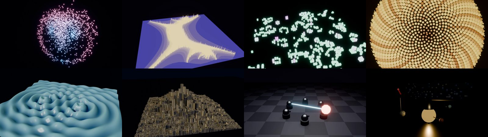
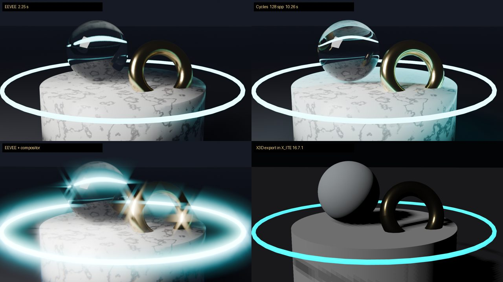

# A tour of Blender, through X3D eyes (26 Nov 2026)

Demo: x3d.demo `docs/demos/blender-tour/v1/` (page, the 45-second reel, the X3D files, the scripts). Add-on:
x3d-blender-io main 699e497 (2.7.8). Blender 5.3.0 on macOS arm64; X_ITE 16.7.1 in headless Chromium (SwiftShader).

## The idea in plain words

Blender has a lot that X3D does not: node programs that recompute every frame, simulations that remember the last
frame, procedural materials, drivers. To see where the line falls, Blender was driven by script through four feature
areas in a real window, and at each stop the scene was exported with the X3D add-on and opened in X_ITE. Then eight
procedural demos were rendered and cut into a 45-second reel in Blender's own Video Sequencer.

## What crosses, and what does not

| In Blender | In the X3D export | Seen |
|---|---|---|
| Geometry Nodes output, instances | Meshes for the current frame | stop 1, X_ITE |
| Scene Time noise, Simulation Zone state | Not carried: one frame | stop 1 |
| Instance attributes that drive a material | Lost: one flat colour | stop 1, X_ITE |
| Principled base colour, metallic, roughness, emission | `PhysicalMaterial` | stop 3, X_ITE |
| Procedural textures | Not carried unless baked to an image (0 `ImageTexture`s) | stop 3 |
| Glass transmission | No X3D 4.0 field: an opaque sphere | stop 3, X_ITE |
| Keyframes | `TimeSensor` + `PositionInterpolator`, only with `use_animation` (off by default) | stop 4 |
| Drivers | Evaluated and baked frame by frame: `OrientationInterpolator`, 120 keys | stop 4, X_ITE |
| Shape keys moved by a driver | No `CoordinateInterpolator` written | stop 4 |
| Grease Pencil | Not carried | stop 4 |
| X3D `RigidBody` positions, on import | Placed where the file puts them (issue #99) | stop 2 |

The same still life four ways: EEVEE 2.25 s, Cycles 10.26 s (128 samples, Metal GPU; the first run took 364 s while
Cycles compiled its kernels), EEVEE with the compositor, and the X3D export in X_ITE. Placement, camera, lights, the gold
and the neon survive; the marble (a node graph) and the glass (transmission) do not.

## Rules it suggests for the exporter

- **Values cross, programs do not.** Anything computed by a node graph each frame has to be evaluated (a frame), baked
  (keys, images) or re-expressed in X3D's own event nodes.
- **Baking is the bridge.** Drivers already arrive as interpolators because the exporter samples world matrices per
  frame. The same idea would carry shape keys (`CoordinateInterpolator`) and procedural materials (an image bake).
- **Say when something is dropped.** The add-on's loss receipt counts drops in the file's head (`dropped=3` on the
  still life); the table above is what those counts were.
- **Defaults decide what people see.** `use_animation` is off, so the first export of an animated scene is a still.

## What the scripts had to learn (Blender 5.x)

A final render reads Simulation Zones from their cache (step the frames in order first); the Simulation Output's first
socket is `Skip`; an attribute stored on instances is read with Attribute type Instancer; Stretch To stretches along +Y;
Euler XYZ applies Z last; EEVEE refracts only with ray tracing on in the scene and the material; the Video Sequencer
shows the workspace's `sequencer_scene`, and FFMPEG output needs `media_type = "VIDEO"`.

## Not checked

Anything by a person's eye; any machine but one Mac; a baked rigid-body fall as X3D (a background bake recorded no
motion); why X_ITE draws nothing for a hand-written `RigidBodyCollection`.
