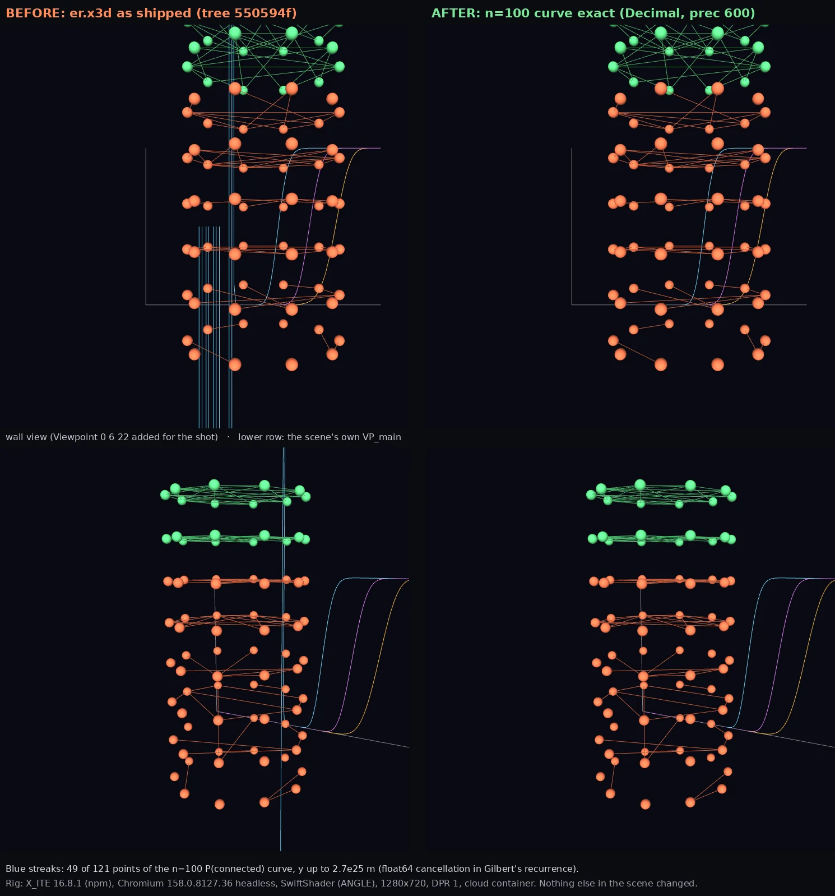

# The new rules on a new stack: x3d.downey (26 Nov 2026)

The glTF-Validator parity checks (x3d_mcp #31) and the USD rulebook checks (#32, #34) were written against fixtures and
two corpora of other people's files. **Do they help or hurt a new integration?** Test bed: x3d.downey, 19 rooms after
Allen Downey's *Modeling and Simulation in Python*, *Think Complexity* and *Think Stats* plus a hub (20 X3D 4.0 scenes),
already accepted under its own Loom profile with 17 of 17 witnesses and three blind second readers.

**Answer: they helped and broke nothing.** 0 new errors, so the Loom gate still accepts 20 of 20. 12 new findings: one true
defect that every earlier witness had passed, seven false alarms (fixed the same day), four profile-only advisories.

- **Evidence:** x3d.loom `runs/20261126-downey-rules/` (predictions written before the run, `RESULTS.md`, raw validator
  output, scripts). **Learnings:** x3d.loom `LEARNINGS-downey.md`, failure modes 444 to 450 (the stack's own foldback is
  415 to 443). **Check fixes:** x3d_mcp `tests/test_downey_findings.py`.
- **Instruments:** x3d_mcp 4d433af (the stack's own commit, before #31) and 5543a7b (main), CPython 3.12.3, lxml 6.1.3;
  Gilbert's recurrence in `decimal` at 600 digits as the exact reference; X_ITE 16.8.1 in Chromium 158 (SwiftShader).

## Before and after the new rules

| x3d_mcp | XSD valid | Errors | Warnings | Infos | Time, 20 scenes |
|---|---|---|---|---|---|
| 4d433af | 20/20 | 0 | 0 | 212 | 0.50 s |
| 5543a7b | 20/20 | 0 | 1 | 223 | 1.27 s |
| with this day's check fixes | 20/20 | 0 | 1 | 216 | |

| New finding | Rule source | n | Verdict | Grade |
|---|---|---|---|---|
| `coordinate-precision` in the random-graph room | SimReady VG.020 / RTX limit | 1 | **true defect** | Confirmed |
| `mesh-colocated-points` on LineSet and PointSet | SimReady VG.016, OAV WeldChecker | 7 | false alarm, now fixed | Confirmed |
| `interpolator-constant` on per-entity animation | SimReady VG.015 | 2 | profile-only | Confirmed |
| `transparent-open-mesh` on translucent ribbons | SimReady VG.022 | 2 | profile-only | Confirmed |

## The defect

The room draws the probability that a random graph is connected, using Gilbert's exact recurrence. In 64-bit floats the
recurrence subtracts two numbers that agree to every digit, then multiplies the noise by binomials as large as 5e28.
For 100 nodes, 49 of the 121 drawn points are wrong, up to 2.7e25 m tall. The room's checked numbers (the p at which the
graph is connected 10%, 50% and 90% of the time) are right, which is why nothing caught it: every check, the JavaScript
twin (same algorithm, so bit-for-bit agreement), and the blind reader (right method, safe points) looked where float works.

It arrived as a **warning**, and the Loom's meaning gate reads only errors, so the gate stayed green. The warning's advice
was "move the origin or use CoordinateDouble", which would have hidden a wrong number; past 2^38 units it now says the
value is suspect.

## What this says about new integrations

| Effect | Result |
|---|---|
| Gates broken | 0 of 20 |
| True defects found | 1, missed by 17 witnesses |
| False alarms | 7, from a mesh rule applied to lines and points; 0 after the fix |
| Advisories | 4 SimReady-only infos; keep them info and label their source |
| Cost | validation 2.5x slower, still 0.06 s a scene |

Not shown: a fix inside x3d.downey itself, other browsers, a GPU.
