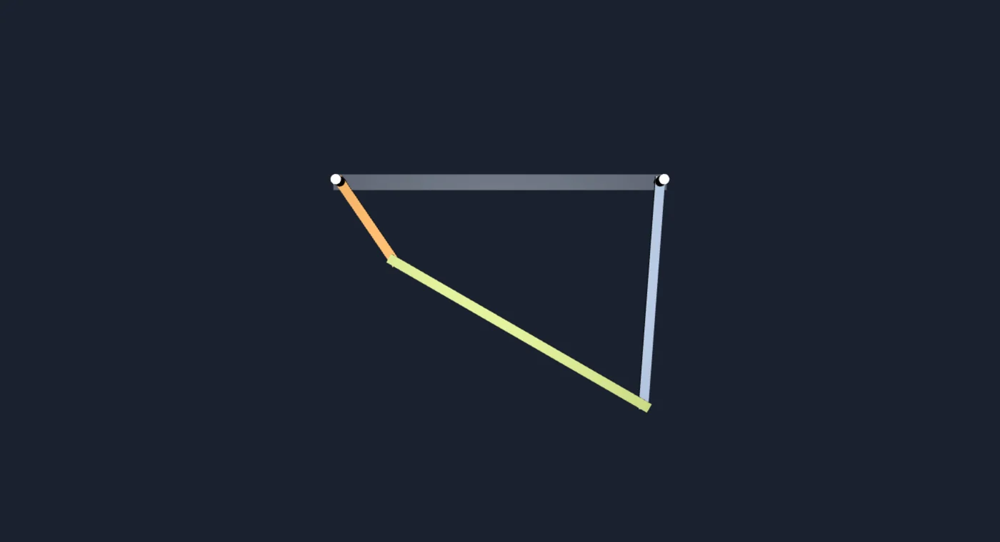
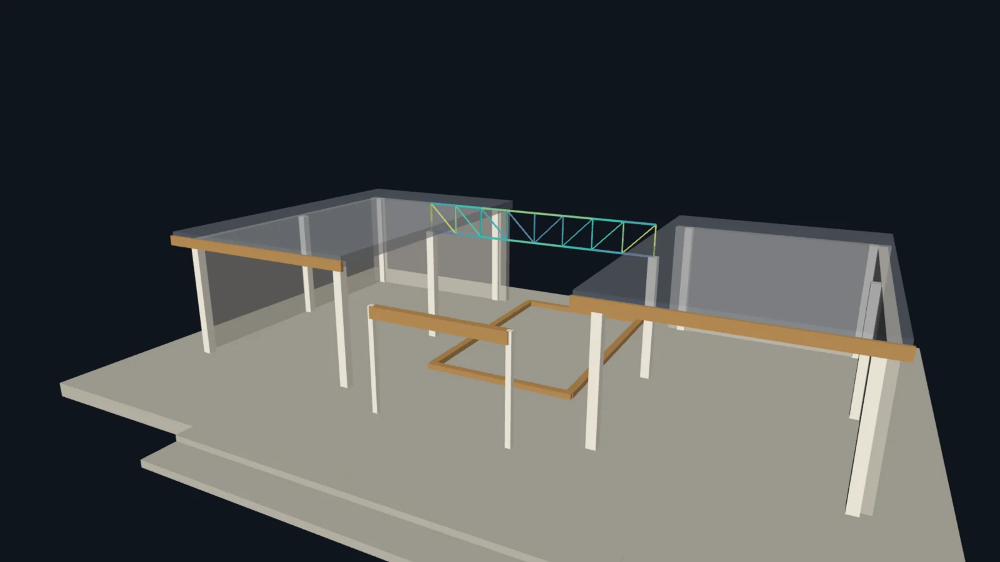
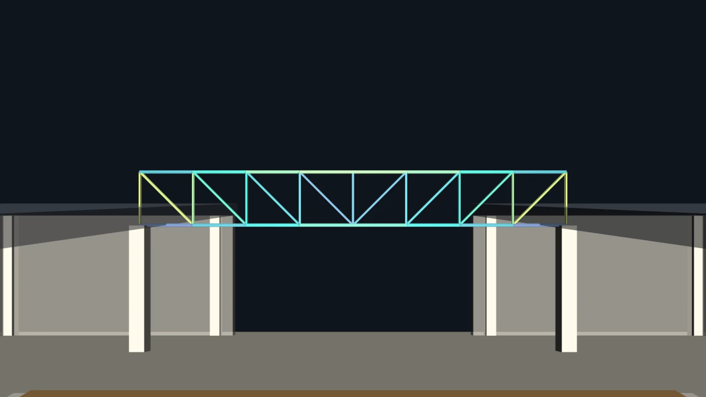
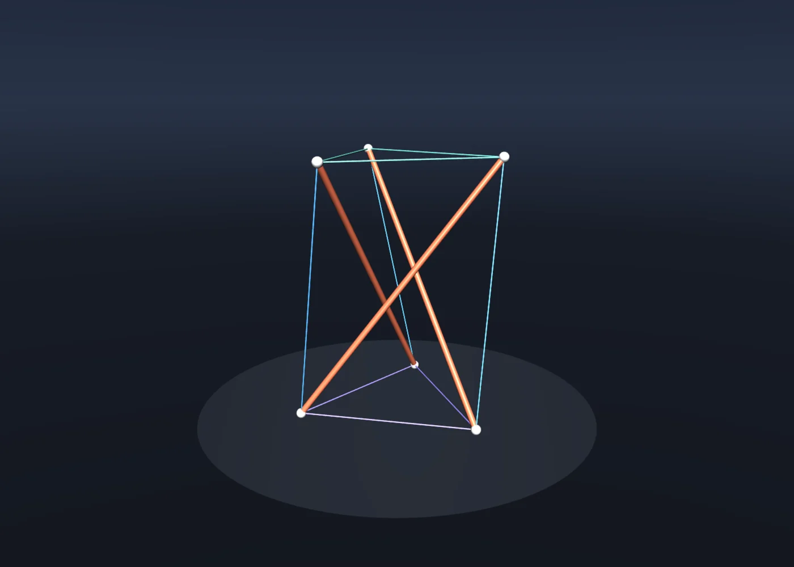
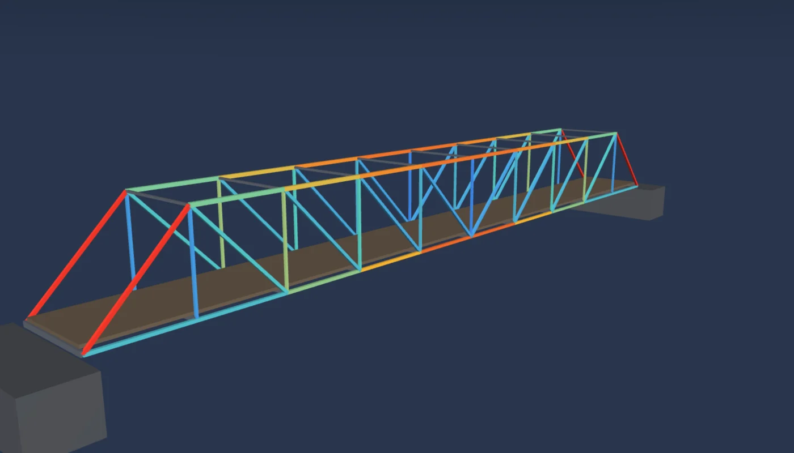

# The engineering playbook: what it is, what paid for it, what is still open

Source of truth: x3d.loom `ENGINEERING-PLAYBOOK.md`, with the two studies in `x3d.engineering/` and the card in `kit/templates/ENGINEERING-STUDY-CARD.md`. Failure modes 505 to 513 are in x3d.loom `LOOM-v1.md`.

Status 28 Nov 2026, updated the same day after the two fixes in section 5. Grades: **C** Confirmed (ran here, number named), **L** Likely (read or reasoned), **S** Suspected.
Rig for every number: Python 3.13, Node v22.23.5, IfcOpenShell 0.9.0.post1, Rapier 0.21.0, cannon-es 0.20.0, the x3d.loom bridge reader at 4a8dcd2, validator x3d_mcp `fa4a8e3` (X3D 4.0 schema plus semantic checks). Stills: X_ITE 16.5.1 in Chromium 158 headless on a software rasteriser (SwiftShader), no GPU.
Every C below is measured by the thread that built it. Nobody else has recomputed any of it, so read each as Likely until someone does.

**Not for construction.** Both studies are worked examples. No licensed engineer has reviewed either.

## 1. The one-line answer

The Loom had a science playbook and a physics playbook and no engineering one. It has one now, built the way the other two were: two studies ran first, and every pattern in it names the study that paid for it. Science asks whether a thing is true. Engineering asks whether it is **enough, under which rule, by how much, and what was lost on the way in**.

## 2. The spine: twelve patterns

| # | Pattern | In one line | Paid for? |
|---|---|---|---|
| E1 | Requirement first | Every claim traces to a numbered "shall" with a check that can fail | yes, 13 requirements |
| E2 | Margin, not match | Demand, capacity, utilisation per member and case | yes |
| E3 | Name the code and its edition | Each clause says where it was read, with a grade | yes: 1 of 5 clauses L, 4 of 5 S |
| E4 | Units and frames are the interface | Declared in the file, checked at every boundary | yes |
| E5 | Identity survives exchange | Joined by id, never by count | yes: 111 of 111, 33 of 33 |
| E6 | Loss receipt per format | Carried or lost, both lists measured | yes |
| E7 | Benchmark ladder | Closed form, identity, second solver, each with a wrong twin | yes, 12 references |
| E8 | Sweep the envelope | Claim a range, probe beyond it, report both | yes: 4 crank speeds |
| E9 | Failure table | Each control names the requirement it must break | in part: 21 of 21 caught, no severity ranking |
| E10 | As-operated replay | Recorded operation replayed against the model | **no** |
| E11 | Independent check | Likely until a second reader recomputes | in part: second solvers, no second person |
| E12 | Configuration and a plain label | Pinned tools, hashes, "not for construction" | yes: two receipts |

Four are new to the Loom (E1, E2, E3, E9). Eight extend laws it already had. No new law.

## 3. Study A, Mechanical: a four-bar linkage on three engines

A crank-rocker (0.30, 0.90, 0.70, 1.00 m) in steel, resisting 1,200 N·m at the rocker. **10 of 10 gates, 8 of 8 controls caught** (C; 8 gates at the first run, 2 added with the adapter fix).

| What | Number | Limit |
|---|---|---|
| Transmission angle over the turn | 49.99° to 108.03° | 45° to 135° |
| Coupler force, worst crank angle | 2,238 N at 0° | |
| Coupler yield | utilisation 0.060 | 1.0 |
| Coupler Euler buckling (governs) | utilisation 0.735, margin 0.361 | 1.0 |
| Pin double shear | utilisation 0.308 | 1.0 |
| Paper checks against each other | 8.9e-16 to 6.3e-11 | 1e-12 to 1e-6 |

The yield check sits at 6 % and looks like the answer. Buckling governs at 73 %.

**Engines as instruments.** One X3D RigidBodyPhysics file, three engines, four crank speeds. An engine qualifies when rocker error is at most 0.5°, pin gap at most 1 mm and out-of-plane travel at most 5 mm.

| Crank speed | Engines that qualify | Which |
|---|---|---|
| 1 rad/s (claimed) | 3 of 3 | built-in, Rapier, cannon-es (cannon-es with 0.7 % to spare on the plane check) |
| 3 rad/s (probe) | 1 of 3 | Rapier |
| 10 rad/s (probe) | 1 of 3 | Rapier |
| 30 rad/s (probe) | 0 of 3 | none |

**The finding: a hinge is not a portable crank pin.** X3D 4.0 clause 37.4.12 says "A hinge may not travel more than π radians (or the equivalent angle base units) in either direction from its initial position." With four hinge joints the built-in engine stops at 3.1447 rad. The Rapier and cannon-es adapters travelled 18.94 and 18.53 rad and, at the first run, wrote no note.

**Corrected the same day: two readings, not one.** The first version of this page said the engine that looked broken was the one following the standard. That holds for the X3D sentence. But ODE, the engine the component was modelled on (L), says "For rotational joints, this stop must be greater than -pi to be effective" (ODE v0.5 user guide, 7.5.1), so there a stop at exactly π is no stop, and the two adapters follow that. Which the standard intends is not settled here.

| Engine | Default | With `hingeStop: 'x3d'` |
|---|---|---|
| Built-in | 3.1447 rad | 3.1447 rad |
| Rapier 0.21.0 adapter | 18.94 rad, now with a note naming the clause | 3.1573 rad |
| cannon-es 0.20.0 adapter | 18.53 rad, now with a note naming the clause | 3.1621 rad |

## 4. Study B, Civil and AEC: a building's loss receipt and a roof truss

The Confluence building (IFC4, 500,619 bytes) against its X3D scene, then a Pratt truss designed across its court and written back as IFC4 and X3D. **22 of 22 gates, 13 of 13 controls caught** (C).

**The loss receipt.**

| IFC says | In X3D | Measured |
|---|---|---|
| 111 products with a body | 111, joined by GlobalId | names and classes equal on 111 of 111 |
| geometry | meshes | worst bounding box 5.3e-6 mm, volume 8.1e-9 relative; 300.95 m³ in all |
| Pset_Bridge.Status, Surface | metadata, appearance name | equal on 111 of 111 |
| Pset_Bridge.EditablePlacement, Role | **lost** | present on 0 of 111 |
| Site, Building, Storey and the tree that joins them | **lost** | 0 of 3 |
| 29 extruded solids | triangles only | parameters lost, volume kept |

The geometry crossed almost perfectly. Half the property keys on every element did not, and nothing said so until the receipt was written. Counts would not have helped: when two elements trade identities, ids, names and classes still read 111 of 111, and only the per-element quantities notice.

**The truss.** Span 8.0 m, read from two IFC columns and not typed. 18 joints, 33 members, four load cases.

| What | Number | Limit |
|---|---|---|
| Governing member (end vertical, compression, 1.2 D + 1.6 Lr) | 43,737 N against 79,309 N, utilisation 0.551 | 1.0 |
| Runner-up (end diagonal, tension) | utilisation 0.542 | 1.0 |
| Largest slenderness in compression | 93.3 | 200 |
| Midspan deflection, D + Lr | 7.42 mm, span / 1078 | span / 240 |
| Two solvers for the member forces | agree to 1.6e-14 | 1e-9 |
| Numbers in the IFC and the X3D against the design bank | 33 of 33 in each | all |

**The honest part.** Of the five code clauses behind "passes", one was read from a source that quotes the code (L) and four were recalled from memory (S). The arithmetic is checked to 1e-14. The rules it was checked against are mostly not.

## 4b. A third study, added later on 28 Nov: tensegrity

A three-strut tensegrity prism designed for an 800 N load, and the six-strut classic. 17 of 17 gates, 17 of 17 controls. It was built under the playbook and did not pay for it; it added no pattern and failure modes 526 to 531. Full page: [tensegrity-study.md](tensegrity-study.md).

## 4c. A fourth study, added later on 28 Nov: a truss footbridge

A 30 m steel truss footbridge under a moving crowd: influence lines, patterned load, sizing, deflection and footfall frequency, cross-checked against OpenSeesPy. 17 of 17 gates, 14 of 14 controls. Failure modes 544 to 550. Full page: [footbridge-study.md](footbridge-study.md).

## 5. What the studies changed in the toolchain

| Finding | Evidence | State |
|---|---|---|
| Two physics adapters let a default-range hinge turn and did not say so | travel 18.94 and 18.53 rad against 3.1447 | **Fixed 28 Nov**: both write a note naming clause 37.4.12, and an option applies the stop. 43 of 43 adapter tests, 11 new. Default behaviour unchanged (the study's pose hash is identical) |
| The first Rapier stop did not let go | under a reverse torque the bar ended at 3.1417 rad, on the stop | **Fixed before it shipped**: a test written for "it lets go" caught it; the bar now ends at 0.086 rad (built-in −0.443) |
| The validator's name rule called free-text names illegal: 34 errors on a scene the schema accepts | x3d_mcp `fa4a8e3`, `naming-convention` against `X3dUnifiedObjectModel-4.0.xml` | **Fixed 28 Nov** in x3d_mcp `4519043`: the rule reads the field's type from the object model (10 nodes: 4 CAD, 6 metadata). 34 errors to 0; 3 new tests failed first; full suite 2,025 passed |
| Dropping the pattern load case changes no utilisation here, so only a coverage gate catches it | control `drop-pattern-case` fails coverage and nothing else | a property of this truss, kept as a control |

## 6. The other six disciplines

One page each in the playbook, no results. Each names the first study that would turn the page into a chapter.

| Discipline | In the repos today | First study |
|---|---|---|
| Controls, modelling and simulation | seven modelling rooms, a study card, no feedback loop | a PID loop with gain and phase margin, drawn with Followers |
| Robotics | one MuJoCo arm, a ragdoll, Newton references | a URDF arm to X3D joints with every link name kept |
| Aerospace | one flight log replay | a transfer orbit held to the closed form |
| Networked simulation (DIS) | 6 nodes parsed, nothing sent | a gateway, an entity that moves, a hashed replay |
| Electrical | nothing that is a circuit | a KiCad board to X3D, one filter against a second solver |
| Underwater | nothing | a tank test in six degrees of freedom over DIS |

## 7. Open

- Nobody outside the session has recomputed a number.
- Four code clauses need someone with the texts.
- The failure table has no severity ranking, and neither study has operating data to replay.
- Which reading of the hinge stop the X3D standard intends. Each engine here now states its own; the question belongs to the standard's authors, and nothing has been sent to anyone.
- No real GPU, no second browser, no paired visual review. The stills are a look, not a witness.
