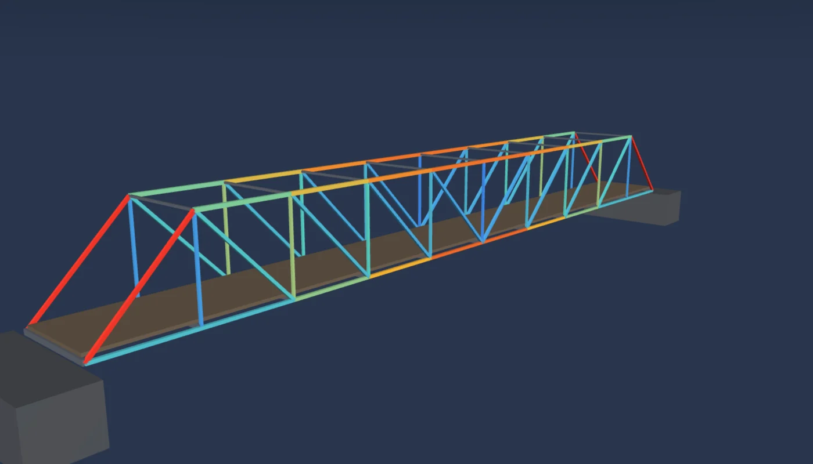
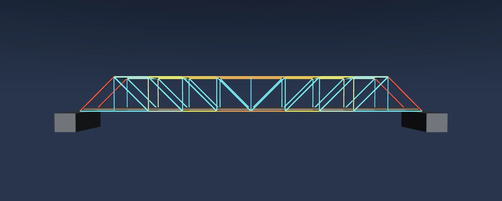
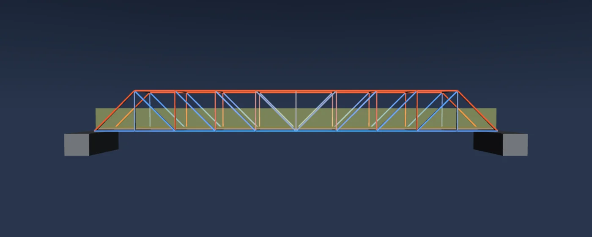

# A truss footbridge under a moving crowd

Source of truth: x3d.loom `x3d.engineering/footbridge/` (card, solver, check, scenes, teaching page) and the section "A fourth study" in `ENGINEERING-PLAYBOOK.md`. Failure modes 544 to 550 are in x3d.loom `LOOM-v1.md`. Receipt: x3d.loom `runs/engineering-footbridge-20261128/`.

Status 28 Nov 2026. Grades: **C** Confirmed (ran here, number named), **L** Likely, **S** Suspected.
Rig for every number: Python 3.13.18, numpy 2.5.3, OpenSeesPy 3.8.0, Node v22.23.5, validator x3d_mcp `0d60c12`. Stills: X_ITE 16.5.1 unpatched in Chromium 158 headless on a software rasteriser (SwiftShader), no real GPU, no second browser.
Every C below is measured by the thread that built it. Nobody else has recomputed any of it, so read each as Likely until someone does.

**Not for construction.** A worked study. No licensed engineer has reviewed it. It is a plane model of one truss: no wind, no lateral vibration, no fatigue, no connections, bearings, deck or foundations.

## 1. The one-line answer

A roof carries loads that stay put. A bridge carries people who do not, so the first question is not "how strong under a full deck" but "where must the crowd stand to hurt each member most". The answer is a shape per member, its influence line. With it, a 30 m Pratt truss footbridge sizes to five square hollow sections, sags span/770 and rings at 4.02 Hz empty. **17 of 17 gates pass and 14 of 14 planted faults are caught.**

## 2. The bridge

30 m simply supported through truss, 10 panels of 3 m, 3 m deep, two trusses 3 m apart, each carrying half the deck. 37 members and 20 joints per truss, statically determinate. Crowd load 90 psf (4.31 kPa), placed to give the worst effect; factors 1.25 or 0.90 on dead load and 1.75 on the crowd; member strength by AISC 360. Loads from one code and strength from another is a study choice.

## 3. What the mathematics says

| Finding (C) | Number | How it is held |
|---|---|---|
| Members that reverse when the deck is part-loaded | 8 of 37; none under a full deck | exact areas of each influence line against a scan of 3,000 short loads |
| Midspan diagonal D5 | +74.5 kN and −37.0 kN; a full deck shows only +31.9 kN | a full-deck-only envelope is a planted fault, and it is caught |
| An influence line is a deflected shape | lengthen one member by one unit and the deck moves into that member's line; 37 members agree to 8.9e-16 | solved from the transpose of the equilibrium matrix (Müller-Breslau) |
| Sizing | top chord 120 × 6, bottom 100 × 5, end posts 100 × 6, verticals 80 × 4, diagonals 100 × 5 mm; end post governs at 0.996 | joint equilibrium, the stiffness method and OpenSeesPy agree to 2e-9 N |
| Deflection | 39.0 mm under the full crowd, span/770 against a limit of span/360 | stiffness method, virtual work and OpenSeesPy |
| First vertical frequency | 4.02 Hz empty (limit 3.0 Hz); 2.26 Hz with the design crowd's mass on the deck | own eigen-solve against OpenSeesPy, 7e-13 Hz |
| The member that carries nothing | the centre vertical takes 0 kN from the crowd; without it the top chord's slenderness goes from 64 to 129 and its strength from 627 to 257 kN against a demand of 563 kN | bank `probes.V5` |
| Depth from 2 m to 4 m, sized again each time | steel 1,825 to 2,389 kg per truss with no trend; frequency 3.18 to 4.51 Hz; sag 66 to 27 mm | bank `probes.depth` |

**Chords are sized by the full deck and webs by the partial one.** Every chord and end post has a one-signed influence line, so the whole crowd is its worst case. The diagonals and verticals have lines that change sign inside the span.

**The crowd is heavier than the bridge.** The design crowd is 439 kg on every square metre, 19.8 t on a deck whose truss, floor and steel weigh 8.9 t. The frequency rule is written for the empty bridge and passes. With the crowd's mass the same mode falls inside walking pace (1.6 to 2.4 Hz, recalled from memory, S).

## 4. What X3D held and what it could not

| Carried in the scenes | Not carried |
|---|---|
| Member centre lines and section widths, read back and compared with the model | Supports, loads and load factors |
| 13 numbers and labels per member as metadata | The influence lines, deflection, the mode shape and frequency |
| The crowd walk as colours keyed from 21 static solutions | Wall thickness: a Box has no wall |

The teaching page (x3d.loom `x3d.engineering/footbridge/page/`) carries its own statics in JavaScript and is held to the Python bank on 37 members and 21 crowd positions, within 1 mN, which is the bank's rounding. A control that loads whole panels misses by 17.1 kN.

## 5. What it taught the Loom (failure modes 544 to 550)

| # | In one line |
|---|---|
| 544 | All 33 tubes of the earlier roof truss were inside out; a mesh writer now measures the volume of what it wrote |
| 545 | A global sign error in the statics matrix passed every check that shared the matrix; an independent code caught it |
| 546 | The card predicted the wrong failing gate for a thin diagonal; the card is amended with a date, the limit is not moved |
| 547 | A full-deck load case shows no reversal; the patterned one shows 8 |
| 548 | A frequency rule checked at one mass state hid the crowded state |
| 549 | In a determinate truss forces do not see a wrong area; cross-check a displacement and a frequency too |
| 550 | A pale neutral colour washed a signed colour scale to white under the scene's lights |

## 6. Open

- Nobody outside the session has recomputed a number.
- Eight of ten code lines are recalled or chosen: the dead-load factors, span/360, the 3.0 Hz rule, the slenderness and wall limits, tensile yielding. Someone with the AASHTO and AISC texts should confirm them.
- Lateral vibration under a crowd is the well-known footbridge problem and is outside a plane model.
- No connection is designed, and connections are where steel bridges are decided.
- No real GPU, no second browser, no paired visual review. The stills are a look, not a witness.
