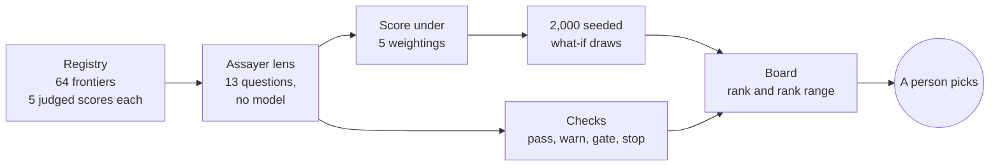

# The frontier board: where the Loom could go next, and how sure anyone can be (23 Nov 2026)

Code and record: x3d.gobbler `frontier/` and `mascot/` (PR #6). Full notes: x3d.loom `LEARNINGS-frontier-board.md`.
No language model was called and nothing was spent. Ranks on this page are one model's opinion, graded Suspected.

## The idea in plain words

A project with many possible next steps usually picks by gut feel. Here the picking was written down so it can be
checked. Sixty-four possible directions ("frontiers") were listed. For each one, five things were scored from 1 to 5
by a model: relevance, how much it would teach the Loom, weight in the wider world, how good it would look, and
effort. Those five scores are opinion. Then a small program, the Assayer's frontier lens, asked thirteen fixed
questions of every frontier and did the arithmetic.

The Loom is the project's memory: its laws, failure modes and receipts. The Gobbler is the agent that uses that
memory. The Assayer is the Gobbler's organ that checks work against thirteen rules from the AI Engineering Atlas.



## The thirteen questions, in plain words

| Thesis | The question asked of a frontier | Worst outcome |
|---|---|---|
| T1 | Is the grader a named tool whose version can be pinned? | warn |
| T2 | Do known-bad examples exist, so the grader can be shown to catch them? | warn |
| T3 | Is the result read from a file or a tool, not from someone's account of it? | gate |
| T4 | Can a trial be repeated exactly from a seed? | warn |
| T5 | If a person or a model is the judge, has the judge been checked against trusted labels? | gate |
| T6 | Can a private slice be held back? | warn |
| T7 | Does it need outside data, and on what licence? | stop |
| T8 | Is something optimising against the grader? Then it needs controls and a hidden judge | stop |
| T9 | Is more than one agent sharing a channel? | warn |
| T10 | Is prior work cited by path, and is it really there? | note |
| T11 | Does the first step cost money? | gate |
| T13 | If a search runs, is its stopping point written before it starts? | warn |

T12 is the lens's own conduct: a stop is printed beside the rank and never averaged away.

## What came out

| Measure | Value | Source |
|---|--:|---|
| Frontiers | 64 (25 domain, 15 AI engineering, 11 algorithmic, 10 generative art, 3 adversarial) | registry |
| Unexplored | 22 | registry (declared) |
| Prior-work paths cited, missing | 101, 0 | looked up on disk in 9 checkouts |
| Clean, warn, note, gated, stop | 30, 18, 2, 11, 3 | `assay_frontiers.py`, Python 3.13.18 |
| First steps with no model call | 54 of 64 | registry (declared) |

Top ten under the balanced weighting: x3d.xray, cross-engine differential rendering, BIM through IfcOpenShell,
OpenUSD conformance, quality-diversity evolution of scenes, STEM and maths, prompt injection through 3D files, a
public scoreboard of models, the hostile-file corpus against every reader, physics engines.

## How sure is the order? Not very, and the board says so

Suppose each opinion is wrong by one point, and the weights by up to 30 percent. The program tried that 2,000 times
(seed 7) and recorded where each frontier landed.

- A top-20 frontier moves across **31 places** on average between its 5th and 95th percentile rank.
- No frontier is in the top 10 in more than **81 percent** of tries.
- **15** frontiers reach rank 3 or better in their good tries. That group is the first tier.
- A second seed (23), never looked at while tuning, gave the same top-10 set: 10 of 10.

So the honest reading is a tier, not a podium. Changing what you care about changes the winner too: weighting for
flywheel gain puts cross-engine rendering first, for spectacle x3d.xray, for gravitas OpenUSD, for a quick win the
token economy of X3D.

## A small experiment with a lesson: the bred mascot

The new Gobbler mascot wears the board as its tail: one feather per frontier, longer for a higher score. For one
version the fan's shape was bred by a program that keeps the nine best different birds out of 1,920 tried
(MAP-Elites, seed 11). It was scored on how much area the fan covers without feathers overlapping, and every kept
bird had to pass the X3D validator (x3d_mcp at b5c9956). All 135 kept candidates passed.

| | Run 1 | Run 2 |
|---|--:|--:|
| Settings the search could change | 8 | 7 |
| Median feather as a share of the longest (true value 0.752) | 0.812 to 0.861 in 9 of 9 birds | 0.752 in 9 of 9 birds |

In run 1 one setting had been left open by mistake: the one that turns a score into a length. The search used it.
Making middling feathers longer covers more area, so every kept bird did it. The picture got a better score by
telling less of the truth. Run 2 locks that setting. Then five of nine birds turned their feathers edge-on, which
hides overlap from the front (graded Likely: seen, not isolated).

**For students:** a program that optimises a score will change anything you let it change. Lock the numbers that
carry meaning before you start, keep one judge it never sees, and expect a second trick after you close the first.

## One bug the validator caught

The camera behind the fan was first written as `orientation='0 0 0 3.142'`: a half turn about no axis. The helper
that aims cameras breaks at exactly 180 degrees. The validator's `rotation-zero-axis` check refused the file. X_ITE
would have drawn something anyway, which is the point of validating before rendering.

## Try it

```bash
git clone https://github.com/hagopjay/x3d.gobbler && cd x3d.gobbler
pip install -r flyte/requirements.txt -r tools/requirements-validation.txt pytest
python3 frontier/assay_frontiers.py --out /tmp/board        # rebuild the board
python3 -m pytest -q frontier/tests mascot/tests            # 26 tests
python3 serve.py                                            # then open http://localhost:8831/mascot/
```

Change a score in `frontier/frontiers.json`, run again, and watch how little or how much the tiers move.
