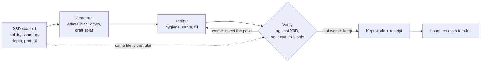

# Generate, refine, verify: holding a world model to account with X3D (24 Nov 2026)

Kit and receipts: x3d.loom `grv-study/`. Notes: x3d.loom `LEARNINGS-grv-paper.md`. Failure modes 247 to 251 in x3d.loom `LOOM-v1.md`.

## The idea in plain words

A generative world model (World Labs Atlas, the API behind Marble) paints a walkable 3D world from pictures, depth and a prompt. Nothing in what comes back says how wrong the geometry is. X3D can: an X3D file states the solids, the cameras and the open air, and a validator checks the file itself. So one X3D file does two jobs. It tells the generator what to paint, and it is the ruler the result is measured with. Refinement (Blender, scripted passes on the splats) sits between the two.

## Keeping the ruler honest

If the same cameras build a world and score it, verification wins by construction. Every study world therefore has 12 cameras that are sent and 12 that are never sent, and a list of hidden trap regions (an open stairwell, the space under a statue's arms) that no stage reads. Scores come only from those.

## Four arms, one generated splat

| Arm | Meaning |
|---|---|
| G | the Atlas splat as returned (aligned on sent cameras) |
| G+R | the same splat after blind clean-up |
| G+V | the same splat with a verify report |
| G+R+V | clean-up, carving and filling, each pass kept only if verify says it did no harm |

## Pilot results (3 worlds, 1 seed; three r187 + Spark 2.4.0, Chromium SwiftShader; validator x3d_mcp 4d433af)

| World | Atlas depth vs X3D depth (median) | Splat error G / G+R / G+R+V | Held-out holes G / G+R+V | Trap defects left G / G+R+V |
|---|---|---|---|---|
| Cross-hall | 2.17% | 55.8 / 55.3 / 26.4 mm | 67.3% / 32.5% | 2 / 0 of 4 |
| Stairwell | 1.27% | 40.2 / 40.2 / 31.7 mm | 41.9% / 12.9% | 4 / 1 of 4 |
| Courtyard | 2.15% | 76.8 / 72.7 / 38.5 mm | 65.2% / 23.8% | 2 / 1 of 4 |

Splat error: distance from each visible splat centre to the nearest X3D surface. Holes: X3D surface seen from held-out cameras with no splat within 50 mm.

## What it shows, and what it does not

- **The gated worlds look worse.** Held-out renders show speckled fill and a courtyard sky carved to black (the X3D has no sky, so every sky splat counted as open air). The pipeline won on geometry and lost on pictures: a gate that checks only geometry rewards edits that damage the picture. Next: a picture gate on every pass, carving only inside the volume the X3D encloses, fill coloured from the generated views.

- With all three stages, error fell 21 to 52% and holes 52 to 69% against the best other arm: the pre-registered 20% bar is passed on 3 of 3 worlds. Three worlds is a pilot, not proof.
- Blind clean-up changed almost nothing here, and in an earlier Marble world it made the picture worse. Refinement pays only when verify chooses it.
- The fill pass copies X3D shape, so part of the gain is by design. Picture quality and a blind human rating are the next tests.
- Verify missed one defect: Atlas painted a statue's outstretched arms as a staff held across the body. Depth and air checks cannot see meaning; a semantic check is needed beside them.
- Depth fidelity depends on how much of the frame the X3D fills: 1 to 2% when it fills the frame, 3.8% when it fills a tenth (the Penrose stairs).

Atlas outputs belong to World Labs under its developer terms (personal, non-commercial) and are not published here. Takedown on request.
