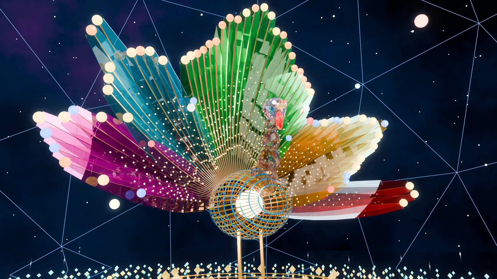
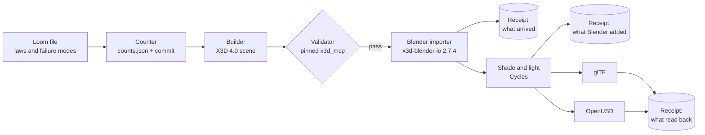
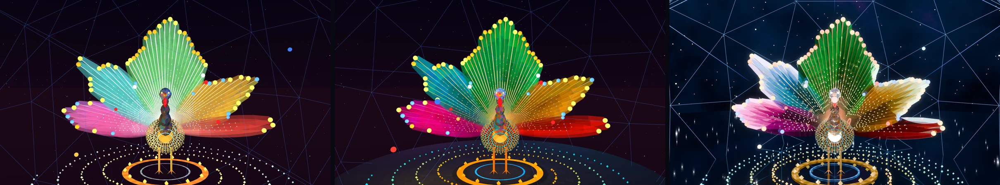

# The glass Gobbler: one X3D scene through Blender, counted at every door (24 Nov 2026)

Code, scene, stills and receipts: x3d.gobbler `mascot/glass/`. Full notes: x3d.loom
`LEARNINGS-glass-gobbler-blender.md`. No language model was called and nothing was spent.



*Cycles, Blender 5.3.0, CPU. Every mesh, colour, camera and animation in this frame came in through the
x3d-blender-io importer (2.7.4). The glass materials, floor, lights, sky and glow were added in Blender and are
listed in the render receipt.*

## The idea in plain words

The Gobbler is the project's mascot, and it is also a chart. Each tail feather is one direction the project could
take, from the [frontier board](frontier-board.md). This version makes the bird out of the Loom itself:

| Part of the bird | What it counts | Today |
|---|---|---|
| gold ribbons that weave the body | laws of the Loom | 44 |
| blue rings across them | theses of the AI Engineering Atlas | 13 |
| beads spiralling on the floor | failure modes the Loom has recorded | 228 |
| tail feathers | frontiers on the board | 64 |

The first three numbers are not typed anywhere. A small script reads the Loom's own file, counts the rows, and
writes down which commit it counted (x3d.loom `139896f`). When the Loom gains a law, the bird gains a ribbon.

Then the scene takes a trip, and something is counted at each door so nobody has to take the pictures on trust.



## What arrived, and what did not

**Into Blender.** All 84 shapes arrived, with all 8,928 faces, all 7 cameras at the right angle of view, the 4
lights, the 7 animations, the colours and the translucency. Three things to know:

- Three instructions that make the coloured lights orbit were dropped. The importer printed each one by name,
  which is exactly what a good tool does with something it cannot carry.
- The stars are points, and Blender's renderer does not draw bare points. They needed a small extra step.
- Every triangle arrived with its own three corners, not shared with its neighbours. That matters for glass,
  which needs a front and a back; the corners have to be joined first.

**Out of Blender.** The same scene was saved as glTF and as OpenUSD, and each file was opened again and counted.

| | glTF | OpenUSD |
|---|---|---|
| glass materials (10) | 10 | 10 |
| lights (8) | 4, the soft panel lights are gone | 8 |
| stars (3 clouds) | gone | kept |
| animation (7) | 7, as keyframes | kept, but as a cached motion, not keyframes |

## Why the frame looks the way it does

- The fan is lit from behind by two large coloured panels. Glass lit from the front looks like plastic.
- The floor is a dark mirror. It showed the two panels as white discs until they were hidden from reflections.
- The pearls on the feather tips carry a colour that means something. At first they glowed so hard that every one
  turned white, so the glow was turned down until the colours came back.
- The blue cage of lines is a sphere, and the camera sits just outside it. The nearest bars were thick blurs
  across the picture, so the camera is allowed to see through bars closer than 9 metres.

Each of those is a change made in Blender, not in the X3D file, and each is written into the render receipt under
`added_in_blender`. The picture is honest about which tool did what.

## Bringing the light home to the browser

The Cycles frame looks good because Cycles spends minutes on it. A browser has a few thousandths of a second. So
the light was worked out once in Blender and written back into the X3D file as plain colours, one per face. The
browser then paints those colours and does no lighting sums for them at all. That is a "bake".



*Left: the bird in the browser, lit live. Middle: the same browser and seat, light baked in. Right: the Cycles frame
the light came from. X_ITE 16.7.0, headless Chromium 157, software GL.*

Three things to know about a bake:

- **It cannot hold glass.** What glass shows depends on where you stand, and a bake is made without anyone
  standing anywhere. So for the bake only, each part was swapped for a stand-in that looks the same from every
  side: a matt surface in its own colour that lets some light through from behind and glows a little.
- **Only the colours travel.** The scene was not saved back out of Blender, because that loses names, cameras and
  animation wiring. Blender wrote a list of 11,616 colours, and the program that made the scene wrote it again with
  them. A check first proved Blender's face order was the same as the file's.
- **Valid is not the same as good-looking.** The first bake turned all the gold lemon yellow, the second turned it
  white, the third kept it gold. All three passed the validator. Only looking at a frame told them apart.

The baked scene is x3d.gobbler `mascot/baked/gobbler-baked.x3d`; the colours and every setting are in `bake.json`.

## Try it

```bash
python3 mascot/loom_counts.py --loom ../x3d.loom --out mascot/glass/counts.json
python3 mascot/build_mascot.py glass --board frontier/runs/frontier-2026-11-23/board.json \
    --genome mascot/v6/elites.json --cell 3 --counts mascot/glass/counts.json --out mascot/glass/gobbler-glass.x3d
python3 tools/validate_scene.py mascot/glass/gobbler-glass.x3d
```

The Blender steps are in x3d.gobbler `mascot/glass/README.md`. They need Python with the `bpy` 5.3 wheel and a
checkout of x3d-blender-io.

## Not done

The baked bird has no reflections or refraction, so it is the same bird under the same lights and not the Cycles
picture. The glTF and USD files were read back by Blender only, not by a second tool.
