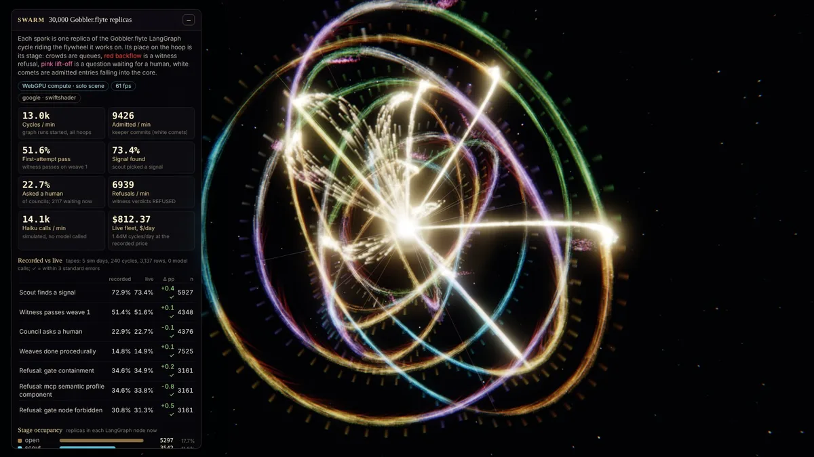
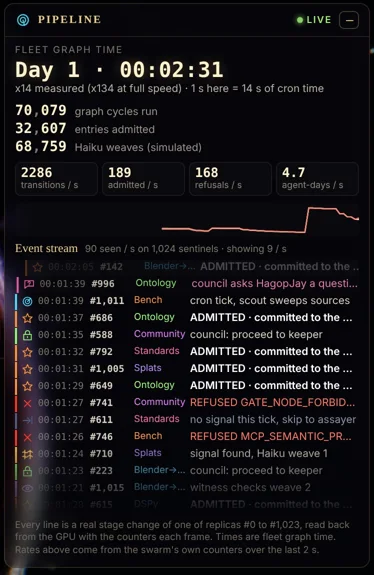
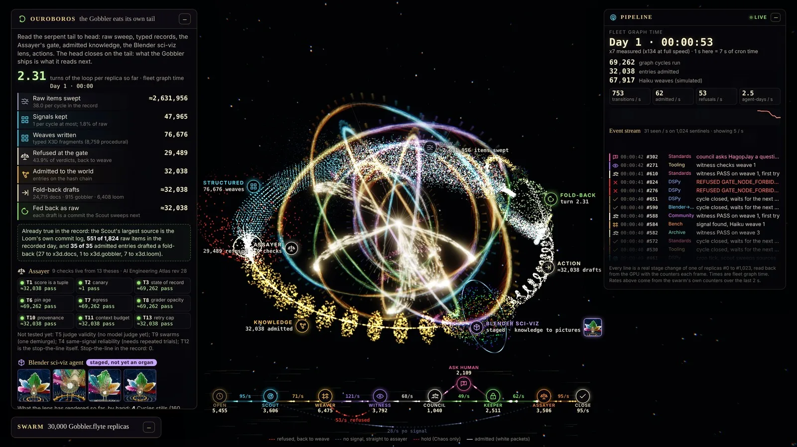
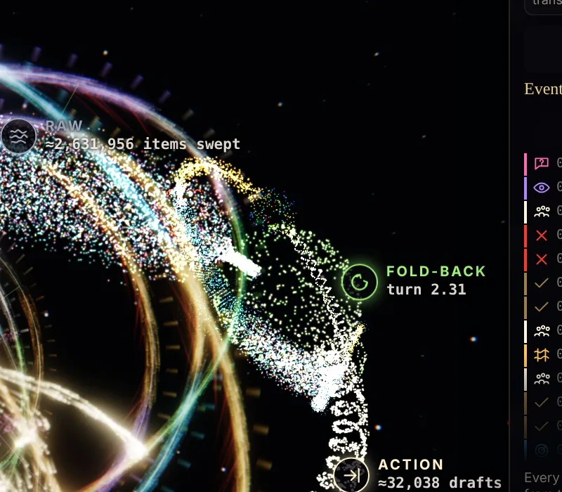
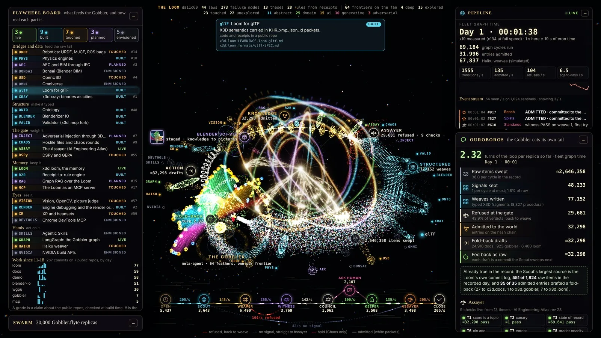
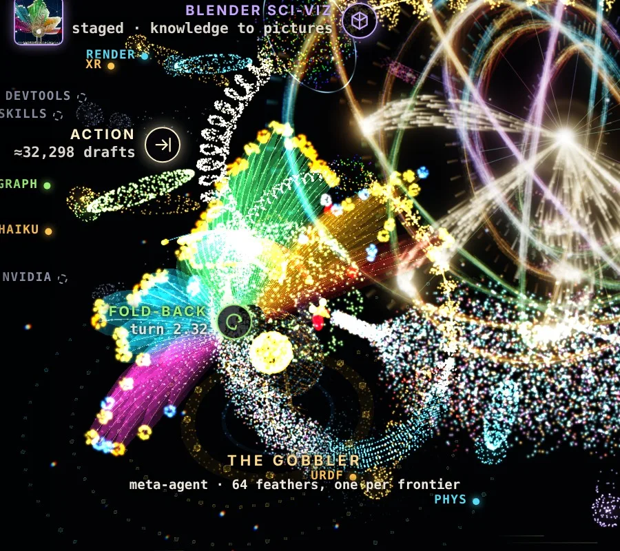

# The Gobbler swarm: 30,000 copies of one agent graph on the flywheels (24 Nov 2026)

Live page: [Gobbler Gyroscope v2](https://hagopjay.github.io/x3d.demo/demos/gobbler-gyroscope-webgpu/v2/index.html)
(the swarm on its own: [solo.html](https://hagopjay.github.io/x3d.demo/demos/gobbler-gyroscope-webgpu/v2/solo.html)).
Full notes: x3d.loom `LEARNINGS-gobbler-swarm.md`. No language model was called and nothing was spent.

*Headless Chrome for Testing 158 with SwiftShader, a software renderer, through the page's offscreen capture mode.
Not a GPU, so no frame rate is claimed.*

## The idea in plain words

Gobbler.flyte is a small LangGraph agent: every half hour it opens, scouts for a signal, weaves an entry, has a
witness check it (a refusal sends it back to weave), lets a council rule, sometimes asks the owner a question,
commits through a keeper and is graded by an assayer. Today there is one. The question was what the dashboard
looks like when there are 30,000.

In this page every spark is one whole copy of that graph. It rides the flywheel hoop its loop belongs to, and its
place on the hoop is the step it is on:

| Where on the hoop | Step |
|---|---|
| first few degrees | open, waiting for the next tick |
| cyan arc | scout |
| gold arc | weaver |
| violet arc | witness |
| red sparks running backwards | a refusal, back to weave |
| white | council |
| pink sparks lifting off | a question waiting for a human |
| green arc, then a white comet into the core | keeper commits |
| amber arc | assayer |

So a crowd on an arc is a queue, red backflow is the refusal rate you can see, and the core glows with how much
gets admitted per minute.

## Why the numbers can be trusted

1. **Every rate comes from a tape.** The real Gobbler.flyte has recorded five simulated days (240 cycles, 3,137
   rows). A script counts every branch, for example the witness passed the first weave in 90 of 175 cycles, and
   the swarm uses exactly those odds. The five days replay the same fixture, so it is one day seen five times.
2. **The graphics card and the reference agree to the bit.** Each copy's state is four whole numbers, never
   decimals, so the JavaScript model and the WebGPU compute shader can be compared exactly: identical in 4 of 4
   runs up to 131,072 copies.
3. **The panel checks itself.** "Recorded vs live" puts each live rate beside the tape's and ticks it when the
   two agree within normal sampling noise. Push the Chaos slider and the ticks turn red, which is the point.

## If there is no WebGPU

The owner's laptop graphics are blocked from WebGPU in Chrome. Version 1 showed a "needs WebGPU" message; version 2
draws the same swarm with WebGL2, run by the same model on the CPU (about 0.44 ms per step for 30,000 copies on the
build machine's Xeon).

## What is not checked yet

The page has not been seen on a real graphics card. The view where the swarm rides the live Babylon scene was only
tested against a stand-in. That check needs a browser with a working WebGPU adapter.

## Version 3: the pipeline at fleet speed

Live page: [Gobbler Gyroscope v3](https://hagopjay.github.io/x3d.demo/demos/gobbler-gyroscope-webgpu/v3/index.html)
(on its own: [solo.html](https://hagopjay.github.io/x3d.demo/demos/gobbler-gyroscope-webgpu/v3/solo.html)). Press P to
hide or show the layer.

The owner asked for a light layer of words, small pictures and icons that makes it obvious the pipeline is moving very
fast. Version 3 adds three things on top of the swarm.

**The stage rail.** The agent graph drawn as a row of icons, from open to close. Little packets run along each line at
the rate the swarm is really producing, and each line is labelled per second. The red dashed loop under weaver and
witness is the refusal backflow; the long grey arc is "no signal, skip to the assayer"; a crimson "hold" line only
appears when the Chaos slider is up.

**The fleet clock.** One trip around a hoop on screen stands for one half-hour cron period, so at full speed the
fleet's clock runs 134 times faster than yours. The clock only counts the work the swarm really did, so a slow
computer shows its own, lower speed-up, and says so.

**The event stream.** A fast log of things that just happened: "#742, DSPy loop, REFUSED by the containment gate",
"#996, Ontology loop, council asks HagopJay a question", "#686, ADMITTED". These are not made up. The page reads the
first 1,024 copies back from the graphics card many times a second and writes a line whenever one of them changes
step. About a dozen lines a second are shown, with refusals, questions and admissions shown more often than routine
steps.

Checked: the graphics card and the reference model still agree to the bit (4 of 4 runs). Not checked: a real graphics
card. In the test machine's software renderer the clock reads x2 to x18 instead of x134.

## Version 4: the Ouroboros

Version 4 answers a different question. Versions 2 and 3 show that the fleet is busy. Version 4 shows what the work
turns into, and where it goes. The demo is at
[x3d.demo, Gobbler Gyroscope v4](https://hagopjay.github.io/x3d.demo/demos/gobbler-gyroscope-webgpu/v4/) (press O to
hide or show the serpent).

An ouroboros is the old picture of a snake eating its own tail. Here the snake is made of 60,000 points of light
around the gyroscope, and you read it from tail to head:

1. **Raw.** A loose, jittering cloud: everything the Scout sweeps up. Five colours for the five kinds of item on the
   recorded day; the grey ones are namesakes (the AMD chip called X3D, a video network called X3D) and drift away.
2. **Structured.** The cloud snaps onto a tidy grid. These are weaves, typed fragments of X3D.
3. **The Assayer's gate.** A bright hoop. Some of the stream turns red and is thrown out. How much follows the live
   refusal rate of the 30,000 copies, so the Chaos slider changes it in front of you.
4. **Knowledge.** Gold beads on a thread: entries admitted to the record.
5. **The Blender sci-viz lens.** A second hoop where knowledge would be turned into pictures. This agent is not part
   of the graph yet, and the page says so: the label reads "staged", and no counter is shown for it.
6. **Action.** A tight white helix: drafts of pull requests back to the docs, the Loom and the Gobbler itself.
7. **The head** closes on the tail. What was shipped is what gets read next.

At the bite there is a smaller serpent with the same parts, and at its bite a smaller one again.

**This loop is already in the record.** On the recorded day, the Scout's largest single source was the Loom's own
commit log (551 of 1,824 raw items), and all 35 admitted entries drafted a fold-back. The receipt-to-rule engine
closes a second loop: 28 candidate rules were drawn from failure receipts and put back to the Blender add-on, where 25
are closed and none is still live on version 2.7.4.

The panel on the left carries the numbers: a funnel from raw items to actions, the nine Assayer checks that run today
(out of 13 theses), what the sci-viz work has rendered by hand so far, the Loom's size (44 laws, 269 failure modes when
the page was built), and a feed of recent commits. Rows marked ≈ are a live counter multiplied by a ratio from the
recorded day. The number of points in each part of the serpent is chosen to look right; the counts are the numbers on
the labels.

Checked: the graphics card and the reference model still agree to the bit (4 of 4 runs); the page with no WebGPU shows
the serpent with no errors. Not checked: a real graphics card, and the serpent over the full WebGPU page.

## Version 5: the Gobbler returns

Version 5 puts the bird back, and says how much of the plan is real. The demo is at
[x3d.demo, Gobbler Gyroscope v5](https://hagopjay.github.io/x3d.demo/demos/gobbler-gyroscope-webgpu/v5/). Keys: G for
the bird, L for the lanes, O for the serpent, P for the pipeline.

**The Gobbler is the serpent's head.** The bird at the bite is the glass mascot itself: the page reads the mascot's
own scene file and draws its 11,736 faces as glass. Its fan is the frontier board, one feather for each of the 64
frontiers. Its heart beats each time the fleet admits an entry.

**The lanes.** Around the serpent sit 27 small moons, one for each part the Gobbler has or is meant to have. Each
sends a stream of light inward to the place on the serpent where its work feeds in: bridges feed the raw tail, the
ontology and the Blender add-on give it structure, the Assayer and the adversarial work stand at the gate, the Loom
keeps what passes, the eyes look at it, and the hands act.

The colour of a lane is its grade, and a grade is a claim about the public repositories:

| Grade | Means | How many |
|---|---|---|
| live (green) | runs inside the recorded Gobbler graph | 3: the Assayer, the Loom, the LangGraph graph |
| built (cyan) | code and receipts exist | 9: physics, glTF, x3d.xray, ontology, the Blender add-on, the validator, chaos rounds, receipt-to-rule, engine debugging |
| touched (amber) | first evidence only | 7: URDF, OpenUSD, DSPy, the Loom as an MCP server, vision, XR, the Haiku weaver |
| planned (violet, dashed) | on the frontier board with a first step written | 3: AEC through IFC, adversarial injection, graph RAG |
| envisioned (grey, dashed) | named on 25 Nov, nothing in the repositories yet | 5: Bonsai, Omniverse, a Chrome DevTools MCP, Agentic Skills, NVIDIA build APIs |

The page will not build if a lane above "envisioned" cannot point at a file that exists. Some plain facts it states:
the Blender add-on is at 2.7.4 today (4.0 is the target), the Haiku weaver is simulated in the record with no model
calls, and engine profiling has not started. How thick a stream looks shows the grade. It is not a measurement.

**The board, the spotlight and the strip.** The left panel lists every lane with its grade and its rank on the
frontier board, then the commits per day on seven repositories since 18 Nov. A card at the top walks through the lanes
one at a time and shows the fact and the file paths behind each grade. A strip across the top carries the Loom's size
today (44 laws, 273 failure modes, 13 theses) and the frontier board by status.

Checked: the graphics card and the reference model still agree to the bit (4 of 4 runs); the page with no WebGPU shows
all of this with no errors. Not checked: a real graphics card, and version 5 over the full WebGPU page.
