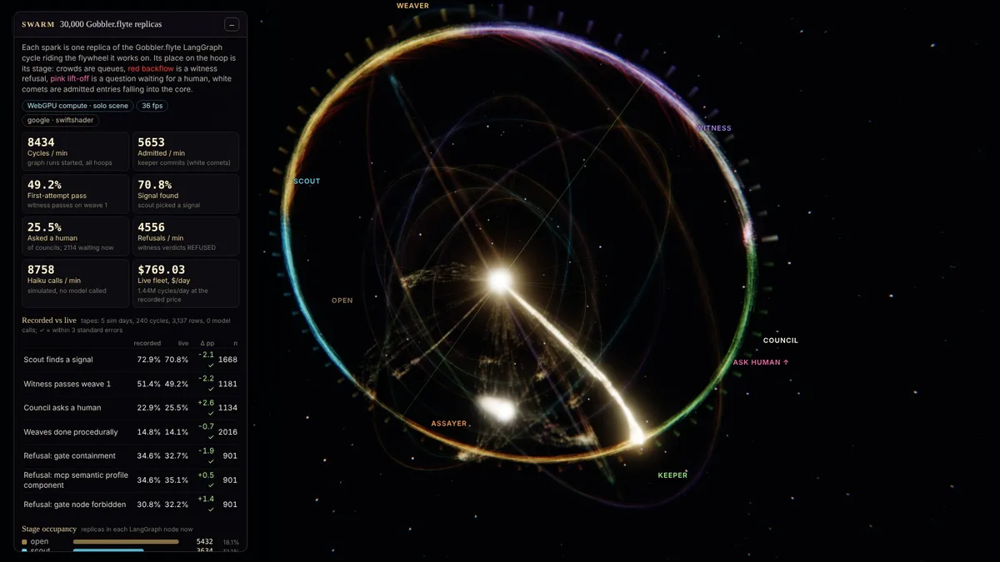
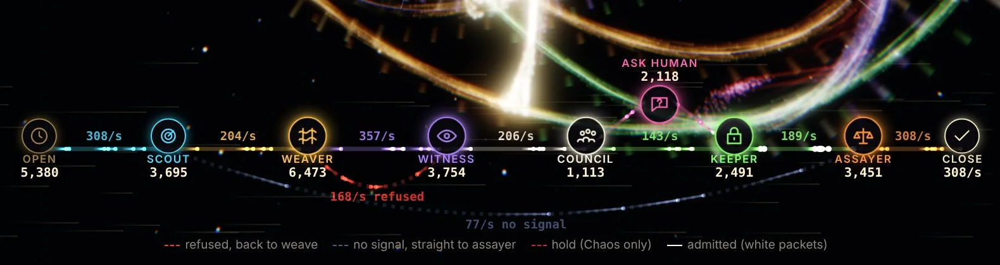

# The Gobbler swarm: 30,000 copies of one agent graph on the flywheels (24 Nov 2026)

Live page: [Gobbler Gyroscope v2](https://hagopjay.github.io/x3d.demo/demos/gobbler-gyroscope-webgpu/v2/index.html)
(the swarm on its own: [solo.html](https://hagopjay.github.io/x3d.demo/demos/gobbler-gyroscope-webgpu/v2/solo.html)).
Full notes: x3d.loom `LEARNINGS-gobbler-swarm.md`. No language model was called and nothing was spent.

*Headless Chrome for Testing 158 with SwiftShader, a software renderer, through the page's offscreen capture mode.
Not a GPU, so no frame rate is claimed.*

## The idea in plain words

Gobbler.flyte is a small LangGraph agent: every half hour it opens, scouts for a signal, weaves an entry, has a
witness check it (a refusal sends it back to weave), lets a council rule, sometimes asks the owner a question,
commits through a keeper and is graded by an assayer. Today there is one. The question was what the dashboard
looks like when there are 30,000.

In this page every spark is one whole copy of that graph. It rides the flywheel hoop its loop belongs to, and its
place on the hoop is the step it is on:

| Where on the hoop | Step |
|---|---|
| first few degrees | open, waiting for the next tick |
| cyan arc | scout |
| gold arc | weaver |
| violet arc | witness |
| red sparks running backwards | a refusal, back to weave |
| white | council |
| pink sparks lifting off | a question waiting for a human |
| green arc, then a white comet into the core | keeper commits |
| amber arc | assayer |

So a crowd on an arc is a queue, red backflow is the refusal rate you can see, and the core glows with how much
gets admitted per minute.

## Why the numbers can be trusted

1. **Every rate comes from a tape.** The real Gobbler.flyte has recorded five simulated days (240 cycles, 3,137
   rows). A script counts every branch, for example the witness passed the first weave in 90 of 175 cycles, and
   the swarm uses exactly those odds. The five days replay the same fixture, so it is one day seen five times.
2. **The graphics card and the reference agree to the bit.** Each copy's state is four whole numbers, never
   decimals, so the JavaScript model and the WebGPU compute shader can be compared exactly: identical in 4 of 4
   runs up to 131,072 copies.
3. **The panel checks itself.** "Recorded vs live" puts each live rate beside the tape's and ticks it when the
   two agree within normal sampling noise. Push the Chaos slider and the ticks turn red, which is the point.

## If there is no WebGPU

The owner's laptop graphics are blocked from WebGPU in Chrome. Version 1 showed a "needs WebGPU" message; version 2
draws the same swarm with WebGL2, run by the same model on the CPU (about 0.44 ms per step for 30,000 copies on the
build machine's Xeon).

## What is not checked yet

The page has not been seen on a real graphics card. The view where the swarm rides the live Babylon scene was only
tested against a stand-in. That check needs a browser with a working WebGPU adapter.

## Version 3: the pipeline at fleet speed

Live page: [Gobbler Gyroscope v3](https://hagopjay.github.io/x3d.demo/demos/gobbler-gyroscope-webgpu/v3/index.html)
(on its own: [solo.html](https://hagopjay.github.io/x3d.demo/demos/gobbler-gyroscope-webgpu/v3/solo.html)). Press P to
hide or show the layer.

The owner asked for a light layer of words, small pictures and icons that makes it obvious the pipeline is moving very
fast. Version 3 adds three things on top of the swarm.

**The stage rail.** The agent graph drawn as a row of icons, from open to close. Little packets run along each line at
the rate the swarm is really producing, and each line is labelled per second. The red dashed loop under weaver and
witness is the refusal backflow; the long grey arc is "no signal, skip to the assayer"; a crimson "hold" line only
appears when the Chaos slider is up.

**The fleet clock.** One trip around a hoop on screen stands for one half-hour cron period, so at full speed the
fleet's clock runs 134 times faster than yours. The clock only counts the work the swarm really did, so a slow
computer shows its own, lower speed-up, and says so.

**The event stream.** A fast log of things that just happened: "#742, DSPy loop, REFUSED by the containment gate",
"#996, Ontology loop, council asks HagopJay a question", "#686, ADMITTED". These are not made up. The page reads the
first 1,024 copies back from the graphics card many times a second and writes a line whenever one of them changes
step. About a dozen lines a second are shown, with refusals, questions and admissions shown more often than routine
steps.

Checked: the graphics card and the reference model still agree to the bit (4 of 4 runs). Not checked: a real graphics
card. In the test machine's software renderer the clock reads x2 to x18 instead of x134.
