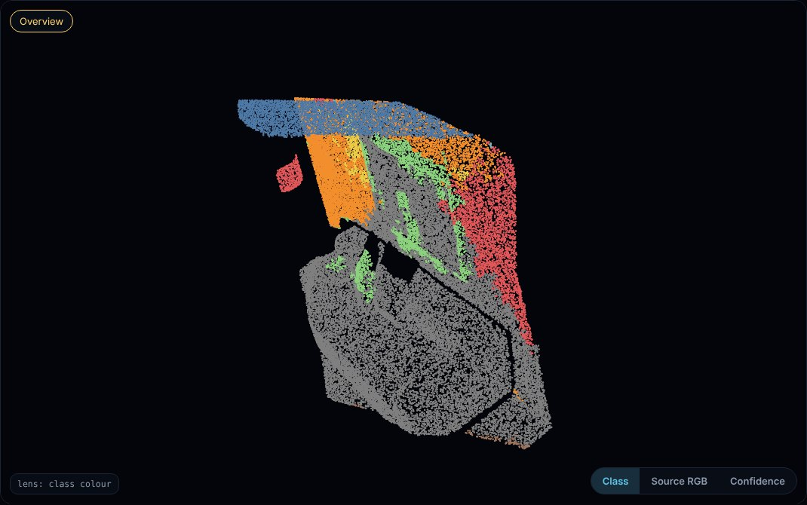

# Open3D-ML bridge: a neural segmentation that stays accountable in X3D (26 Nov 2026)

Demo: x3d.demo `docs/demos/open3d-ml-bridge/v1/` (Demo 81). Code: x3d.ml `o3d_bridge/x3do3d.py`. Fold-back: x3d.loom `LEARNINGS-open3d-ml-bridge.md`, failure modes 309 to 314.
Data: Redwood living-room fragment (Choi, Zhou, Koltun, CVPR 2015), model RandLA-Net S3DIS from [Open3D-ML](https://github.com/isl-org/Open3D-ML) (Intel ISL, MIT). Sources and takedown: the demo's `DATA-ATTRIBUTION.md`.

## The idea in plain words
Open3D-ML is a library of neural networks that label 3D points ("this is a wall, this is a door"). Its output is arrays of numbers. The bridge writes them as an X3D scene where each class is its own group that knows its id, name, point count, share and average confidence, so anyone can hide a class, recolour by confidence, or read the labels back into Open3D. The model, checkpoint hash, library versions and validator verdict are written into the file itself.

## What was measured (each with its instrument)
| fact | value | instrument |
|---|---|---|
| CPU inference | 315,723 points, ~4 s | Open3D 0.20.0, torch 2.13.0, container CPU |
| scene validity | XSD 4.0 valid, provenance chain verified | x3d_mcp fork `4d433af`, x3dprov |
| round trip | class counts exact, worst position error 0.00084 m | `read_segmentation`, cKDTree |
| wrong frame | only 25.8% of labels survive without floor at z = 0 | same model, same points, two runs |
| bridge vs noise | bridged 84.1 ± 1.3%, direct 82.8 ± 3.2%, repeat 87.3 ± 0.6% | 5 runs each, one scene |
| render | 6 frames, 0 console lines | X_ITE 16.7.1, Chromium, SwiftShader (software) |

## What it cannot say
No ground truth exists for this scan, so segmentation quality is Suspected, not measured. No real LiDAR frame was run: 3D-box output is tested on synthetic boxes only. The scan's licence is unstated (cited, removable on request).

## Try it
`X3D_MCP_PATH=<x3d_mcp> pytest tests/test_x3do3d.py` in x3d.ml; install notes in `o3d_bridge/README.md` (Open3D needs torch 2.13.* plus a CUDA-12 runtime library even on CPU).

## Second pass: scored against ground truth (v2, 26 Nov 2026)
Demo: `docs/demos/open3d-ml-bridge/v2/`. Data: Rohbau3D construction-shell scans (Lukas Rauch et al., Universität der Bundeswehr München, doi:10.60776/ZWJFI4, CC BY 4.0; modified, see the demo's DATA-ATTRIBUTION). Same model, three scenes, three runs each, only same-meaning classes scored.
- Ceiling and floor are found in a real shell (recall 97-100% in two scenes).
- Walls mostly are not (38 / 5 / 5%): bare concrete gets called "window". Likely a domain gap, not a bridge fault.
- A multi-storey scene broke the floor-at-zero rule (floor recall 39%).
- New scene lenses: *correct vs ground truth* and *ground truth*. Failure modes 315 to 317 in the Loom.
Still missing: 3D boxes on a real LiDAR frame.
