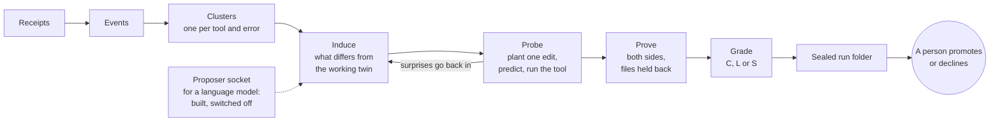

# Receipt to rule: an engine that turns failures into candidate rules (23 Nov 2026)

Spec: x3d.loom `R2R.md`. Full notes: x3d.loom `LEARNINGS-r2r-engine.md`. Code: x3d.loom `kit/loomkit/r2r/`.
Sealed evidence: x3d.loom `runs/r2r-*`. No language model was used, and nothing was sent to any outside project.

## The idea in plain words

When a tool chokes on a file it leaves a receipt: this file, this tool, this error. A person then reads the receipts
and writes a rule by hand ("a boolean must be spelt `true` or `false`"). The receipt-to-rule engine (R2R) reads the
pile instead. It lines each broken file up with its nearest working twin, works out what the broken ones share, and
then builds fresh files to try to catch itself being wrong. A guess that keeps calling the outcome correctly comes out
as a candidate rule with its evidence attached. A guess that does not is still shown, graded Suspected, with what is
missing. A person decides what becomes a law: the engine has no way to promote anything.



## Why X3D makes this possible

A rule needs words. X3D publishes its own: the X3D Unified Object Model lists 267 node types and 4,342 fields, each
with a type. From that table alone the engine knows that `solid` is a boolean and `coordIndex` is a list of indexes
into a sibling `Coordinate`, so it can say "a boolean spelt in a way the reader does not expect" or "an index past
the end of its list" where a format without an object model could only say "the text `TRUE`". The vocabulary has four
tiers, from what the standard says (tier 1) down to a literal value (tier 4, a fingerprint, always flagged as one).

## What a rule looks like

One site (an attribute, an element, or the whole file), a list of tests that must all hold, and at most one list of
places:

| Rule | In words |
|---|---|
| `attr[v:bool_noncanonical & (at:Box@solid \| at:Sphere@solid)]` | At one attribute, at one of two places: a boolean is spelt as something other than `true` or `false` |
| `doc[ge:depth_max:64]` | For the file as a whole: the deepest nesting is at least 64 |
| `attr[v:index_out_of_range & at:IndexedFaceSet@coordIndex]` | An index points past the end of the list it indexes |

A rule's id is a hash of its content, so the same rule found twice has the same name.

## How a rule earns a grade

| Grade | What it takes |
|---|---|
| **C**, Confirmed | A tool observed the failures; the rule fires on no file the tool passed (at least 30 of them); and it called outcomes it had never seen: probes built after the rule was fixed, or receipts held back |
| **L**, Likely | Clean on the receipts, but too few predictions, or a person rather than a tool says the files are wrong |
| **S**, Suspected | A lead: one failure, a fingerprint, a wrong prediction, or a sliver of its cluster. What is missing is written beside it |

Explaining the failures it was shown never earns a rule more than Likely. The grade table is fixed in code and a
proposer, human or model, cannot change it.

## Does it work: a test with a known answer

A rule was hidden inside a stand-in tool, the engine was given only that tool's pass and fail receipts, and the rule
had to come back. A fourth tool fails at random, where the right answer is to find nothing.

| The stand-in tool | Rule hidden in it | Came back | Failures given | Questions asked | Fresh failing files called |
|---|---|---|---:|---:|---:|
| A tool that crashes on a boolean not spelt true/false, but only at the five attributes it reads | `attr[v:bool_noncanonical & (at:Box@solid \| at:DirectionalLight@on \| ... 5 places)]` | word for word, graded C | 19 | 82 | 31 of 31, 0 false alarms in 325 |
| A tool that overflows its stack once nesting reaches 64 levels | `doc[ge:depth_max:64]` | word for word, graded C | 57 | 83 | 140 of 140, 0 false alarms in 325 |
| A tool that crashes when an IndexedFaceSet coordIndex points past its Coordinate list | `attr[v:index_out_of_range & at:IndexedFaceSet@coordIndex]` | word for word, graded C | 40 | 73 | 46 of 46, 0 false alarms in 325 |
| A tool that fails one edited file in eight at random: there is no rule to find | none | 1 rule, graded S; nothing higher | 37 | 123 | |

Instrument: `kit/loomkit/r2r/drivers/rule_tool.py`, seed 1, loomkit.r2r 0.1.0 (`096d1ce649f8b276`). All Confirmed for this
stand-in only.

## On real receipts: the Blender add-on

Receipts: four chaos rounds of 960 one-edit mutants and a sweep of 514 real `.x3d` files, judged by x3d-blender-io
2.7.1 (commit d931551) in bpy 5.3.0 and by x3d.py 4.0.65.8 as that add-on calls it: 16,742 events, 232 of them
failures. The engine built 2,924 test files of its own and ran them through the same tools, 33 minutes on four
cores.

**28 candidate rules: 15 Confirmed, 4 Likely, 9 Suspected.** Across the Confirmed rules, 265
audit predictions came true and 0 were wrong; the Confirmed and Likely rules raise 0 false alarms on the
files the tools passed. 7 of the 17 crash clusters were first seen in a probe: no chaos round had
produced them.

The Confirmed and Likely rules (the full table is in x3d.loom `LEARNINGS-r2r-engine.md`):

| Grade | Rule | Instrument: signature | Failures explained | False alarms on passing files | Held out: failures called; false alarms | Audit probes right / wrong | Closure | Put to add-on 2.7.3 |
|---|---|---|---:|---:|---:|---:|---|---|
| **C** | `attr[v:bool_noncanonical & !v:case_variant & nws:1 & (at:Box@solid \| at:CollidableShape@visible \| ... 24 places)]` | Blender import: `IndexError at import_x3d.py:860 getFieldAsBool` | 133 of 133 | 0 of 1,813 | 35 of 35; 0 of 1,416 | 20 / 0 | open | closed (171 pass, 0 fail) |
| **C** | `attr[v:arity_long & !p:Scene & !v:quoted & at:Transform@translation]` | Blender import: `ValueError at import_x3d.py:1700 translateTransform` | 76 of 149 | 0 of 2,162 | 0 of 2; 0 of 1,416 | 35 / 0 | open | closed (96 pass, 0 fail) |
| **C** | `doc[ge:depth_max:1004]` | x3d.py check: `RecursionError: maximum recursion depth exceeded` | 72 of 72 | 0 of 1,831 | 1 of 1; 0 of 1,469 | 11 / 0 | open | closed (83 pass, 0 fail) |
| **C** | `attr[v:inf & !v:arity_mismatch & (at:GeoViewpoint@fieldOfView \| at:Viewpoint@fieldOfView)]` | Blender import: `ValueError at viewpoint_fov.py:42 blender_camera_angle` | 62 of 62 | 0 of 2,297 | 0 of 0; 0 of 1,416 | 20 / 0 | open | closed (82 pass, 0 fail) |
| **C** | `attr[v:number_unparseable & !p:Scene & !v:quoted & at:Transform@center]` | Blender import: `ValueError at import_x3d.py:1678 translateTransform` (first seen in a probe) | 55 of 62 | 0 of 2,444 | 0 of 0; 0 of 1,416 | 20 / 0 | open | closed (75 pass, 0 fail) |
| **C** | `attr[ge:index_excess:440304889 & ge:ntok:20 & !e.has:ccw & at:IndexedFaceSet@coordIndex & e.child:Coordinate]` | Blender import: `RuntimeError at import_x3d.py:2008 validate_points_field` | 49 of 76 | 0 of 1,887 | 11 of 14; 0 of 1,416 | 15 / 0 | open | closed (63 pass, 0 fail) |
| **C** | `attr[ge:index_max:177662200 & le:index_excess:440304889 & !v:lexical_invalid & at:IndexedFaceSet@coordIndex & e.child:Coordinate]` | Blender import: `RuntimeError at import_x3d.py:2253 importMesh_IndexedFaceSet` (first seen in a probe) | 31 of 31 | 0 of 2,352 | 0 of 0; 0 of 1,416 | 21 / 0 | open | closed (49 pass, 0 fail) |
| **C** | `attr[v:below_min & ntok:1 & (at:Cone@bottomRadius \| at:Cone@height \| ... 7 places)]` | Import, then export: `ValueError at export_x3d.py:2111 _modern_writer` | 31 of 32 | 0 of 1,962 | 0 of 0; 0 of 1,409 | 20 / 0 | open | partly closed (28 pass, 23 fail) |
| **C** | `attr[ge:max_abs:5.05e+38 & e.child:Shape & e.has:DEF & (at:Transform@scale \| at:Transform@translation)]` | Import, then export: `RuntimeError at matrix_safety.py:47 inverted64` | 29 of 119 | 0 of 1,886 | 3 of 6; 0 of 1,409 | 13 / 0 | open | closed (39 pass, 0 fail) |
| **C** | `attr[v:number_unparseable & !p:Scene & at:Transform@scale & ntok:3]` | Blender import: `IndexError at import_x3d.py:1665 translateScale`; also `IndexError at import_x3d.py:1666 translateScale` (C) | 27 of 149 | 0 of 2,024 | 0 of 2; 0 of 1,416 | 24 / 0 | open | closed (128 pass, 0 fail) |
| **C** | `attr[v:inf & !v:arity_mismatch & (at:Arc2D@startAngle \| at:ArcClose2D@startAngle)]` | Blender import: `ValueError at import_x3d.py:4437 _arc_points` (first seen in a probe) | 25 of 28 | 0 of 2,506 | 0 of 0; 0 of 1,416 | 10 / 0 | open | closed (37 pass, 0 fail) |
| **C** | `attr[ge:index_excess:536870902 & e.child:Color & (at:IndexedTriangleSet@index \| at:IndexedTriangleStripSet@index)]` | Blender import: `IndexError at import_x3d.py:1857 importMesh_ApplyColors` (first seen in a probe) | 22 of 30 | 0 of 2,315 | 0 of 0; 0 of 1,416 | 11 / 0 | closed-so-far | still live (0 pass, 30 fail) |
| **C** | `attr[v:float_overflow32 & !p:Scene & !v:lexical_invalid & at:Transform@translation]` | Import, then export: `RuntimeError at matrix_safety.py:47 inverted64` | 16 of 119 | 0 of 1,886 | 0 of 6; 0 of 1,409 | 21 / 0 | open | closed (38 pass, 0 fail) |
| **C** | `attr[ge:index_excess:536870902 & !e.child:Normal & anc:Transform & at:IndexedTriangleStripSet@index]` | Blender import: `IndexError at import_x3d.py:1857 importMesh_ApplyColors` (first seen in a probe) | 14 of 30 | 0 of 2,315 | 0 of 0; 0 of 1,416 | 10 / 0 | closed-so-far | still live (0 pass, 18 fail) |
| **C** | `attr[v:has_comma & nws:3 & (at:Arc2D@startAngle \| at:ArcClose2D@startAngle)]` | Blender import: `ValueError at import_x3d.py:4437 _arc_points` (first seen in a probe) | 3 of 28 | 0 of 2,506 | 0 of 0; 0 of 1,416 | 14 / 0 | open | closed (15 pass, 0 fail) |
| **L** | `elem[ge:nattrs:1 & child:TouchSensor & has:scale & n:Transform & p:Scene]` | Blender import: `IndexError at import_x3d.py:1665 translateScale` | 28 of 149 | 0 of 2,024 | 0 of 2; 0 of 1,416 | 0 / 0 | open | closed (28 pass, 0 fail) |
| **L** | `attr[ge:index_excess:19311468 & at:IndexedTriangleStripSet@index & e.child:TextureCoordinate]` | Blender import: `IndexError at import_x3d.py:1927 importMesh_ApplyUVs` (first seen in a probe) | 9 of 9 | 0 of 2,380 | 0 of 0; 0 of 1,416 | 2 / 0 | closed-so-far | still live (0 pass, 9 fail) |
| **L** | `attr[ge:ntok:20 & at:IndexedTriangleFanSet@index]` | Blender import: `RuntimeError at import_x3d.py:2107 importMesh_IndexedTriangleFanSet` (first seen in a probe) | 4 of 4 | 0 of 2,376 | 0 of 0; 0 of 1,416 | 1 / 0 | closed-so-far | still live (0 pass, 4 fail) |
| **L** | `elem[x:present & n:CoordinateDouble]` | Blender import: `AttributeError at import_x3d.py:1904 importMesh_ReadVertices` | 2 of 2 | 0 of 2,167 | 0 of 0; 0 of 1,416 | 0 / 0 | closed-so-far | still live (0 pass, 2 fail) |

"Closure open" means the rule is right each time it fires and does not yet fire everywhere it should.

## Old rules, new version

A rule is about one tool at one version. `kit/loom r2r replay` put the 2.7.1 rules to add-on 2.7.3 (commit 8e56437),
rebuilding each confirming probe from its recipe. 21 rules are closed: 2.7.3 passes every file they fire on.
6 are still live and 1 is partly closed, although two chaos rounds on 2.7.3 had found no crash at all
(counts are per rule):

| Grade on 2.7.1 | Rule | On 2.7.3 | Files that fail | Files that pass | How 2.7.3 fails |
|---|---|---|---:|---:|---|
| **C** | `attr[ge:index_excess:536870902 & e.child:Color & (at:IndexedTriangleSet@index \| at:IndexedTriangleStripSet@index)]` | still live | 30 | 0 | `IndexError at import_x3d.py:1991 importMesh_ApplyColors` x 30 |
| **C** | `attr[ge:index_excess:536870902 & !e.child:Normal & anc:Transform & at:IndexedTriangleStripSet@index]` | still live | 18 | 0 | `IndexError at import_x3d.py:1991 importMesh_ApplyColors` x 18 |
| **L** | `attr[ge:index_excess:19311468 & at:IndexedTriangleStripSet@index & e.child:TextureCoordinate]` | still live | 9 | 0 | `IndexError at import_x3d.py:2061 importMesh_ApplyUVs` x 9 |
| **L** | `attr[ge:ntok:20 & at:IndexedTriangleFanSet@index]` | still live | 4 | 0 | `RuntimeError at import_x3d.py:2268 importMesh_IndexedTriangleFanSet` x 4 |
| **L** | `elem[x:present & n:CoordinateDouble]` | still live | 2 | 0 | `AttributeError at import_x3d.py:2038 importMesh_ReadVertices` x 2 |
| **S** | `attr[ge:index_excess:20060965 & !v:lexical_invalid & at:IndexedFaceSet@coordIndex & e.has:creaseAngle]` | still live | 46 | 0 | `IndexError at import_x3d.py:2392 importMesh_IndexedFaceSet` x 46 |
| **C** | `attr[v:below_min & ntok:1 & (at:Cone@bottomRadius \| at:Cone@height \| ... 7 places)]` | partly closed | 23 | 28 | `ValueError at export_x3d.py:2177 _modern_writer` x 23 |

Three are real: `CoordinateDouble` stops the import, `MetadataBoolean` stops the export, and an index of hundreds of
millions raises `IndexError` in three mesh readers. The fourth is the exporter refusing a negative radius, which is designed; the
engine worked that gate's rule out from the outside. A chaos round samples. A rule that keeps its probes is a
standing question that can be asked of every later version.

## Limits

- One site per rule: a cause that needs two places compared cannot be written.
- Where the vocabulary has no word, the rule is a fingerprint, graded Suspected and listed as a gap.
- It learns the tool, not the standard. A Confirmed rule says a tool fails, not that a file is invalid X3D.
- A cluster that starts from one or two failures grows into several narrow rules under probing.
- A failure whose file is byte-identical to a passing file has its cause elsewhere (three of the ten Fault Lab faults
  live in the record beside the scene); the engine says so and writes no rule.

## Use it

```sh
kit/loom r2r run MANIFEST --out RUN_FOLDER      # receipts in, candidate rules out
kit/loom r2r show RUN_FOLDER                    # the report
kit/loom r2r check RUN_FOLDER scene.x3d         # pre-flight one file against the candidates
kit/loom r2r replay RUN_FOLDER NEW_MANIFEST     # put old rules to a new version
kit/loom r2r needs RUN_FOLDER                   # what is still open
kit/loom r2r selftest                           # the hidden-rule test
```

A tool joins through a small driver that reads a list of files and writes one line per file: pass, fail and a
signature. A seam for a language-model proposer is built and switched off; whatever it proposes would go through the
same probes and the same grade table.
