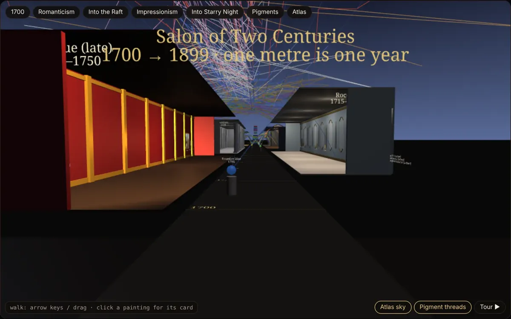
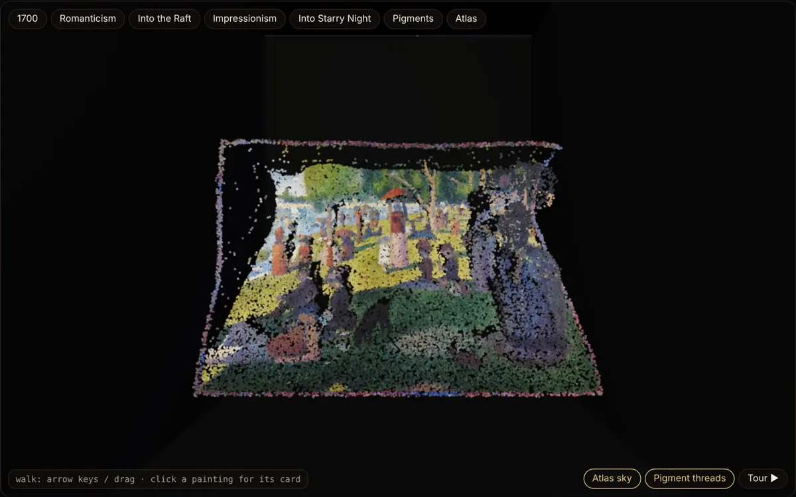
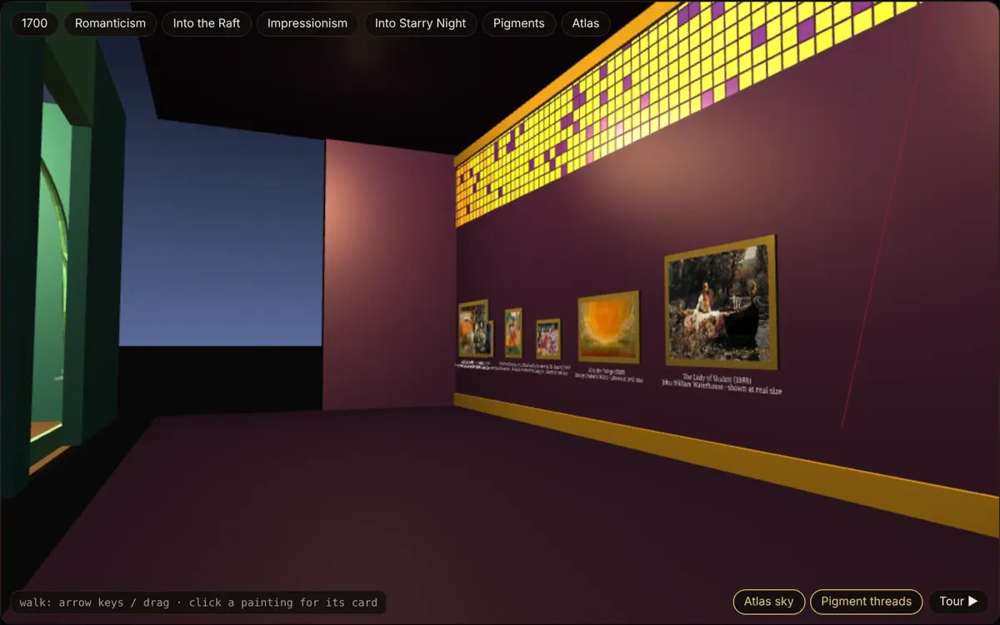

# Salon of Two Centuries: art from 1700 to 1899 as a museum you walk through in time (25 Nov 2026)

Demo: x3d.demo `docs/demos/salon-two-centuries/v1/` (Demo 79), live at https://hagopjay.github.io/x3d.demo/demos/salon-two-centuries/v1/ once merged.
Source: the owner's [ArtHistory.md](https://github.com/hagopjay/gcloud.map/blob/main/ArtHistory.md), nodes A20 to A28 (late Baroque to early Art Nouveau).
Fold-back: x3d.loom `LEARNINGS-salon-two-centuries.md`, failure modes 284 to 289.

## The idea in plain words

One metre is one year. A 200 m corridor runs from 1700 to 1899, and every part of the scene uses that same axis:

| layer | what you see | where the data comes from |
|---|---|---|
| **galleries** | one room per art movement, from its start year to its end year, each built in its own style and light (Rococo mirrors, Neoclassical columns, Gothic Revival ribs, an Impressionist glass roof, a Symbolist gold mosaic, Art Nouveau ironwork). Movements that overlap in time sit side by side | the chart's spans and notes, each note graded Confirmed or Likely |
| **paintings** | 57 public-domain paintings at their real size, each at its own year; click one for its card and credits | Wikidata (sizes, dates, public-domain status) and Wikimedia Commons (images) |
| **walk-ins** | The Raft of the Medusa and The Starry Night as reliefs you step into; La Grande Jatte as 46,000 coloured dots in depth | depth estimated by a small open model run on a CPU; labelled as an estimate |
| **pigment tower** | the new colours of the period (Prussian blue 1704 to synthetic alizarin 1868) on pedestals at their year, with threads to the rooms that used them | conservation history, graded |
| **Atlas sky** | above the rooms, 405 painters' lives drawn as threads across a map of Europe and through time, with gold arcs for "influenced by" and white arcs for "student of" | Wikidata (CC0), read through the QLever mirror |

## Why X3D

1. **Time is a real axis.** Distance in the scene is years, so overlap, gaps and the order of events are things you walk past rather than read.
2. **The credits travel with the scene.** Every painting carries its Wikidata id and year in metadata; a test reads them back from the file: 54 of 54 equal, plus 3 of 3 walk-ins.
3. **Checked like code.** X3D 4.0 schema valid, 0 errors (x3d_mcp validator `4d433af`). It runs on WebGL2 only, so laptops without WebGPU work.

## What we learned

- Wikimedia's own servers refuse fast automated requests from cloud machines. The QLever copy of Wikidata answers them, and images still download slowly from the image server.
- Wikidata stores painting sizes in different units (metres, millimetres, centimetres). Read the unit, or a 2 m canvas becomes 2 cm.
- Shiny gold needs something to reflect. Without an environment map, "physical" metal draws black, so the gilt uses a classic shiny material.
- Only looking catches some faults: a room nobody could enter, and viewpoints that fell through the floor.

## Not tested

A real GPU (all frames are software rendered). Each Commons file page was not opened one by one; public-domain status comes from Wikidata.
