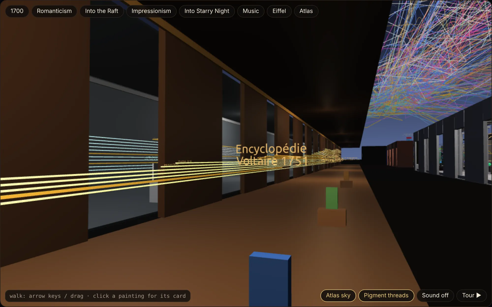
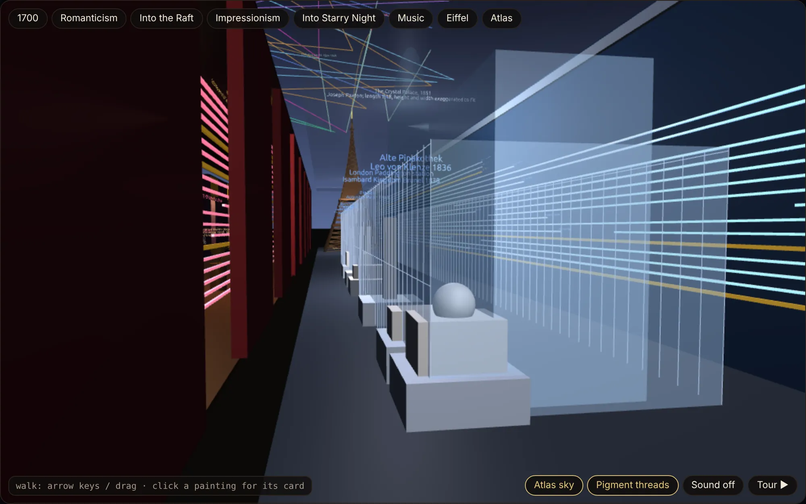
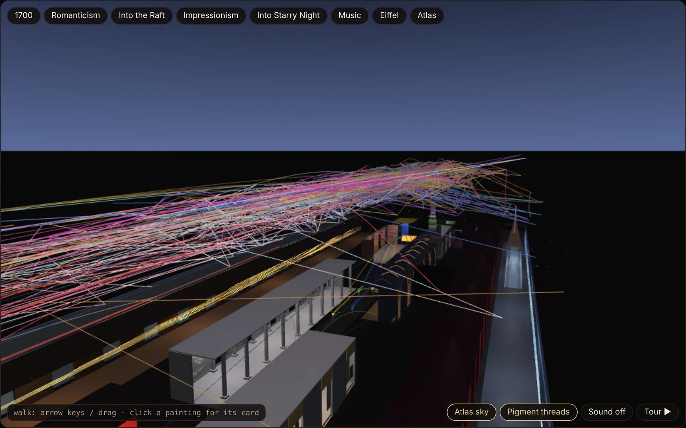

# Salon of Two Centuries v2: writers, thinkers, composers and builders join the paintings (25 Nov 2026)

Demo: x3d.demo `docs/demos/salon-two-centuries/v2/` (Demo 79, version 2), live at https://hagopjay.github.io/x3d.demo/demos/salon-two-centuries/v2/ once merged. Version 1 is unchanged.
Source: the owner's [Western.Epic.md](https://github.com/hagopjay/gcloud.map/blob/main/Western.Epic.md), branch "Enlightenment & Romantic 1750-1900".
Fold-back: x3d.loom `LEARNINGS-salon-two-centuries.md` §8-13, failure modes 290 to 294.

## The idea in plain words

Version 1 made art from 1700 to 1899 a corridor where one metre is one year. Version 2 keeps every room and adds four wings
on the same axis, so the paintings, books, ideas, music and buildings of a given year stand side by side.

| wing | what you see | how many |
|---|---|---|
| **Letters** | each writer's life as a rail from birth to death; books as plaques at their publication year; gold rails for people the Epic names | 60 lives |
| **Ideas** | thinkers and their treatises (The Wealth of Nations, Critique of Pure Reason, The Social Contract) | 45 lives |
| **Music** | composers, and 12 listening posts from Handel (1711) to Verdi (1851) that play when you step in | 45 lives, 12 excerpts |
| **Building** | architects and engineers; 30 buildings as models on plinths; the Crystal Palace (1851) and the Eiffel Tower (1889) | 40 lives |
| **Atlas sky** | everyone's life drawn over a map and through time; magenta arcs show influence across fields, such as a poet shaping a composer | 211 links, 75 across fields |

## Why it matters

1. **Fields meet on one axis.** Beethoven's late quartets, Hegel and the Romantic painters share a stretch of floor, so the timing between them is visible.
2. **Sound without rights problems.** The music is played from the notes of public-domain scores, not from recordings. The score files keep their encoders' terms, and these are credited.
3. **Checked like code.** X3D 4.0 schema valid with 0 errors (x3d_mcp validator `4d433af`). 20 software-rendered frames, none black. It runs on WebGL2, so it works on laptops without WebGPU.

## Honest gaps

- The Epic names 33 people for this branch. 32 were found; Montesquieu was missed by the data filter.
- The tower and palace are proportioned sketches, not measured models.
- The music is a synthesiser reading the notes, not a performance.
- Not yet tried on a real graphics card.
