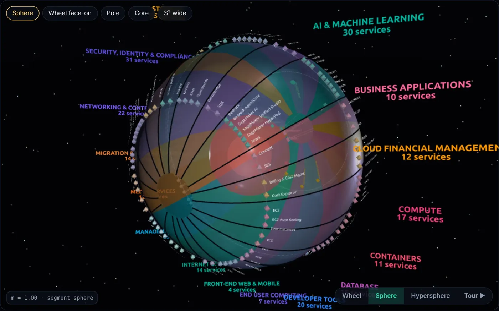
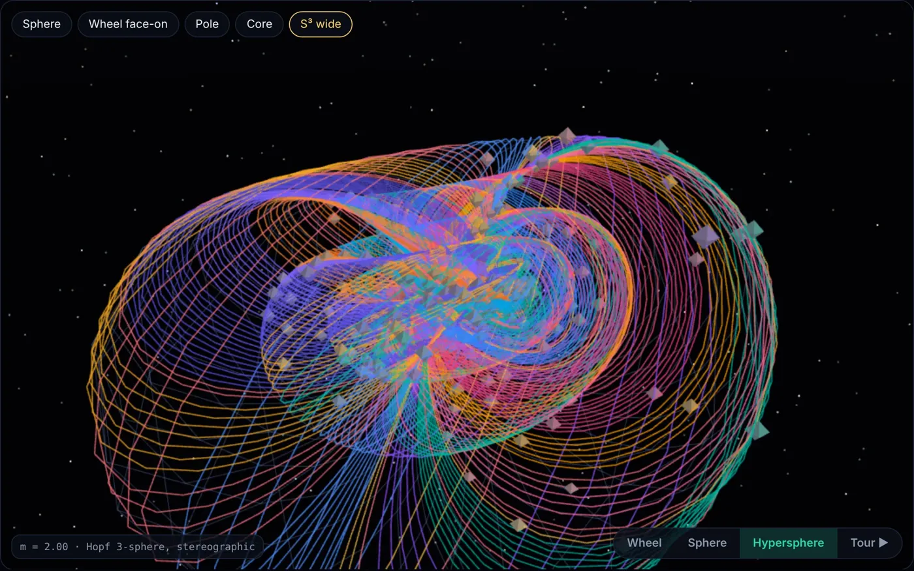

# Segment Sphere: a flat wheel chart, wrapped onto a ball and lifted into four dimensions (25 Nov 2026)

Demo: x3d.demo `docs/demos/segment-sphere/v1/` (Demo 78), live at https://hagopjay.github.io/x3d.demo/demos/segment-sphere/v1/ once merged.
Data: the AWS Segment Wheel, [hagopjay/aws_SegmentWheel](https://github.com/hagopjay/aws_SegmentWheel) (301 services, 19 categories, compiled September 2026).
Fold-back: x3d.loom `LEARNINGS-segment-sphere.md`, failure modes 279 to 283.

## The idea in plain words

A wheel chart puts every item on a flat disc: a wedge per category, a dot per item, rings to spread them out.
X3D lets the same dots live in three shapes, one after another, without copying the data:

| shape | how the chart becomes it | what still means something |
|---|---|---|
| **wheel** | the source page's own numbers: ring radius 204/444/684 of 1000, the exact angle of every dot | wedge width = category size; status becomes depth (new services float up, retired ones sink) |
| **segment sphere** | the wheel is wrapped onto a ball: angle → longitude, ring → latitude | a category's slice of the ball has an area in proportion to its size, just like its wedge; retired services fall into a red core |
| **hypersphere (S³)** | each dot on the ball becomes a circle in four-dimensional space (the Hopf fibration), drawn in 3D by stereographic projection | every two circles are linked like chain mail (45,150 links for 301 services); the three rings become three nested doughnuts |

One `Script` node inside the X3D file morphs between the three. The page only presses buttons.

## Why X3D, not a picture

1. **The data travels with the scene.** All 301 rows (name, category, ring, angle, status, and the 38 lifecycle notes) sit in a `MetadataSet` inside the file. A test reads them back and compares them with the source: 301 of 301 equal.
2. **One file, three views.** A viewer without scripting still gets the sphere, because it is written into the file as the starting state.
3. **Checked like code.** X3D 4.0 schema valid; 0 errors, 0 warnings, 34 notes (x3d_mcp validator `4d433af`).

## Numbers and where they came from

| number | source |
|---|---|
| 301 services, 19 categories, 3 rings (59/99/143) | `build/extract.py` reading the source page; it stops if any count disagrees with the page |
| 263 available, 4 preview, 5 closed to new customers, 29 retired | the source page's glyphs and its lifecycle table |
| 45,150 linked pairs | C(301, 2); any two Hopf fibers link exactly once |
| 4.3 to 5.8 ms per rebuild of the S³ view | the Script's own timer, X_ITE 16.7.1, software rendering (SwiftShader) |
| 0 console errors, 0 black frames of 8 | Playwright + Chromium 158 + SwiftShader, `shots/shots-receipt.json` |

## What went wrong on the way (and is now a rule)

- **Slow script, fast page.** The same math ran 14 times slower inside the X3D Script than in the page. Moving it into a closure fixed it (69.6 → 4.8 ms). Failure mode 279.
- **Circles running to infinity.** A few circles pass near the projection point and become huge; a hard cut drew them as flat polygons. A soft horizon (`tanh`) keeps them smooth. Failure mode 280.
- **Missing glyphs.** The wheel's ◇ and ◦ symbols drew as empty boxes in 3D text; † worked. They are spelled out now. Failure mode 281.
- **Names with spaces.** "Developer Tools" is not a legal metadata name in X3D; the label moves into a child value. Failure mode 282.

## Not tested

A real GPU (every frame is software rendering; X_ITE needs only WebGL2, which a laptop whose GPU is blocklisted for WebGPU still has); other X3D browsers; whether each AWS status is still current today. AWS and its service names are trademarks of Amazon; the demo is not affiliated with AWS.
