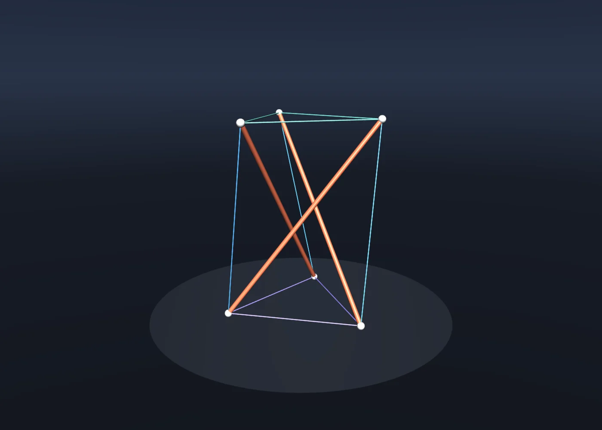
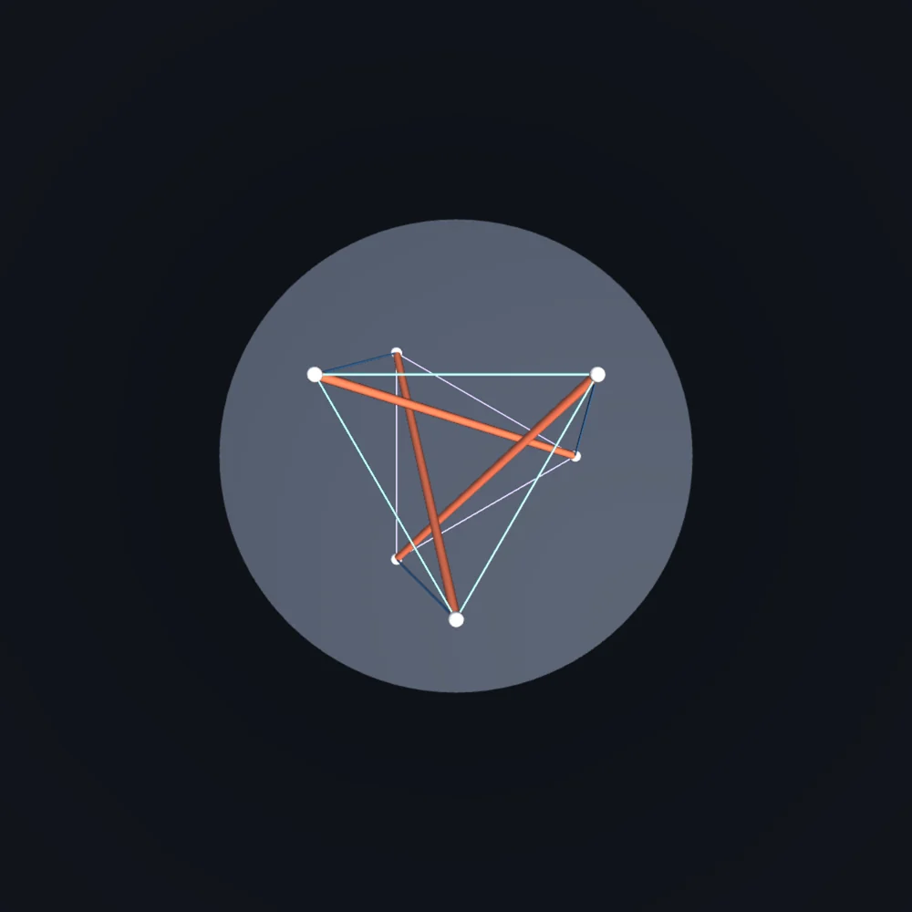
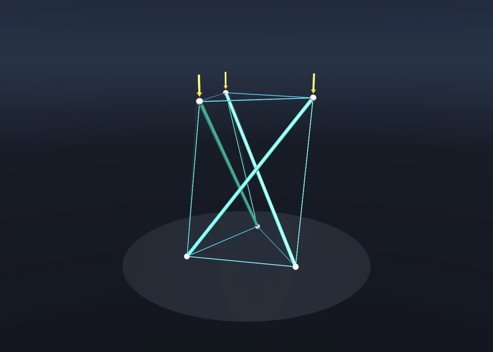
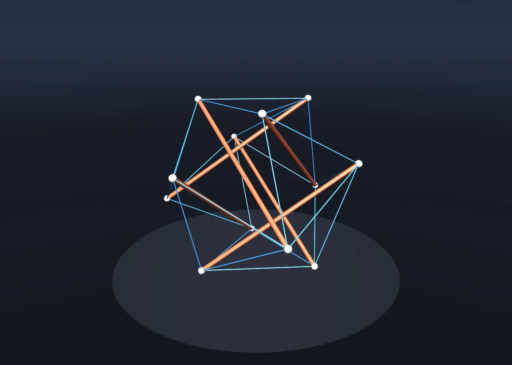

# Tensegrity under the Loom: a prism designed for a load

Source of truth: x3d.loom `x3d.engineering/tensegrity/` (card, solver, check, scenes, teaching page) and the section "A third study" in `ENGINEERING-PLAYBOOK.md`. Failure modes 526 to 531 are in x3d.loom `LOOM-v1.md`. Receipt: x3d.loom `runs/engineering-tensegrity-20261128/`.

Status 28 Nov 2026. Grades: **C** Confirmed (ran here, number named), **L** Likely, **S** Suspected.
Rig for every number: Python 3.13.18, numpy 2.5.3, Node v22.23.5, validator x3d_mcp `ca0e75c`. Stills: X_ITE 16.5.1 unpatched in Chromium 158 headless on a software rasteriser (SwiftShader), no real GPU, no second browser.
Every C below is measured by the thread that built it. Nobody else has recomputed any of it, so read each as Likely until someone does.

**Not for construction.** A worked study. The rope's area, modulus and breaking load and the tube's modulus and yield are recalled from memory (S), and the conclusions scale with them.

## 1. The one-line answer

A tensegrity is not a shape someone draws and then analyses. One matrix decides whether a shape can be tightened at all, how many ways, and how soft it is. For the three-strut prism the answer is: only at a 150° twist, in exactly one way, and with a stiffness that is rented from the prestress. **17 of 17 gates pass and 17 of 17 planted faults are caught.**

## 2. One matrix, four answers

The equilibrium matrix A has three rows per joint and one column per member. Its singular values give the rank r; then self-stress states s = b − r and mechanisms m = 3j − 6 − r.

| Question | Answer (C) | How it is held |
|---|---|---|
| Where does the form come from? | A loses rank at one twist only: 150°, 135°, 126°, 120° for 3, 4, 5, 6 struts, which is 90° + 180°/n. Height, radius and top radius do not move it | bisection on the smallest singular value against the closed form, better than 1e-9 rad |
| Why does it stand? | 12 members, 6 joints, s = 1, m = 1. Maxwell's count says 0 spare members, and 0 = 1 − 1 | mechanisms counted from the null space, not from the formula |
| What is the stress pattern? | Force densities strut : polygon cable : side cable = −1 : 1/(2 sin(180°/n)) : 1 | SVD against the closed form and against the force-density matrix (nullity 4) |
| How stiff is it? | The soft mode has 1.63 N/m per newton of prestress and 0 at 0 N. The next mode is 56 times stiffer | tangent stiffness against finite differences, 1.1e-10 relative |

## 3. The design: a window, not a threshold

Requirement: carry 800 N pressed on the top, with no slack cable, no strut past half its Euler load, no cable past a third of its breaking load, and a drop under 10 mm. Radius 0.40 m, height 1.00 m, struts 1.264 m of 25 × 2 mm aluminium tube, 3 mm rope, 14 load cases.

| Prestress in each side cable | Verdict (C) |
|---|---|
| 50, 100, 200 N | fail: a cable goes slack and the drop is over the limit |
| 400 N | fail: drop over the limit |
| **600 N (design)**, 800, 1,000 N | pass |
| 1,200, 1,400 N | fail: strut and cable over their allowances |

The window is **489 N to 1,114 N**. At 600 N the struts sit at 0.78 of the buckling allowance (0.04 of yield, so buckling governs by a factor of about 20), the cables at 0.77, and the 800 N press drops the top 6.45 mm while turning it 4.66°. The structure is a screw: pushing it down twists it.

Other things the load cases show (C): press, lift and both torques each tighten every cable and load every strut; cut any one cable and no self-stress state is left; two solvers with nothing in common but the member list agree to 5.2e-11 m.

## 4. The six-strut classic

Same code, different member list: 12 joints, 6 struts, 24 cables, s = 1, m = 1 when parallel struts sit half a strut apart. Every cable is √6/4 = 0.612 of a strut, and a strut carries √6 times a cable's force.

## 5. What X3D held and what it could not

| Carried in the scenes | Not carried |
|---|---|
| Geometry, a name per member, per-member metadata (length, prestress, worst force, capacity, utilisation, governing case) | Any physics. X3D 4.0's rigid-body component has six joint nodes and none is a rope, a spring or a distance limit (C, read from the object model in x3d_mcp `ca0e75c`) |
| The press as 17 static solutions played by interpolators | The solve itself, the supports, the material law |

The teaching page (x3d.loom `x3d.engineering/tensegrity/page/`) solves in the browser with a separate JavaScript solver. That solver is held against the Python bank on five load cases (worst 5.8e-10 m), and a control with a wrong prestress pattern misses by 1.3 mm. Every number the page quotes is copied from the bank at build time.

## 6. What it taught the Loom (failure modes 526 to 531)

| # | In one line |
|---|---|
| 526 | A Maxwell check that could not fail, because one side was computed from the other |
| 527 | A solver tolerance below the rounding floor reported failure on a structure in equilibrium |
| 528 | Cables inferred from distance picked up the wrong joints; assert the count first |
| 529 | X_ITE 16.5.1 ground colours seen from above drew wedges; use a sky-only gradient and a one-face floor |
| 530 | A colour ramp scaled to the frame's own maximum made a structure at rest look at its limit |
| 531 | An "error" equal to the report's rounding is not a measurement |

## 7. Open

- Nobody outside the session has recomputed a number.
- Material values are Suspected. Someone with a rope and tube data sheet should replace them.
- Static only: no dynamics, fatigue, rope creep, joints or end fittings.
- No engine cross-check. MuJoCo tendons or PhysX distance joints would be the independent one.
- Whether a member that only pulls belongs in X3D's rigid-body component is a question for the standard's authors. Nothing has been sent to anyone.
- History quoted on the page (Snelson 1948, Fuller's name, Calladine 1978) was checked on the web; Calladine's paper was found by its record and not read.
